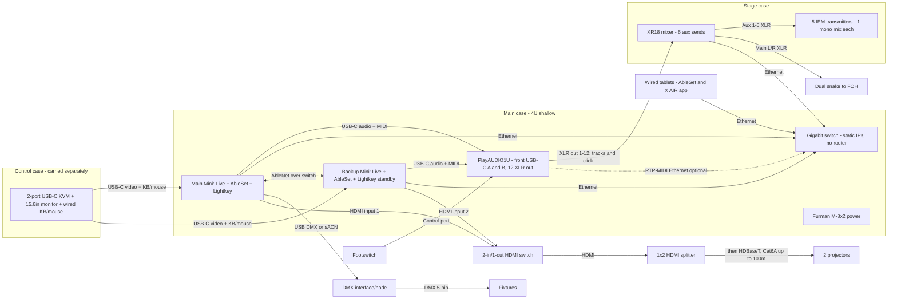
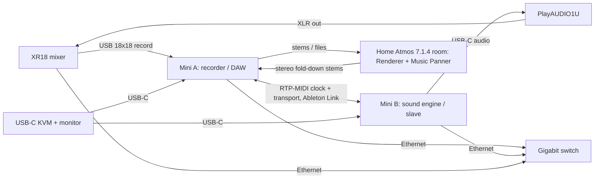

# Eugene Fight Club playback rig

**Show day:** [SHOW-DAY-RUNBOOK.md](SHOW-DAY-RUNBOOK.md) is the printable checkbox list (pack, cable, power-on, checks, failover drill, pack-out). The same order in prose is [docs/guide/07-load-in-runbook.md](docs/guide/07-load-in-runbook.md).

A portable, redundant Ableton + AbleSet playback system built around the PlayAUDIO1U: two cases plus a control case, a perform mode and a record mode, with parts, prices and sources.

Keith wants more mobile than his current rack. The build uses three pieces: a main case, a stage case, and a control case. His existing rack stays home as the record-mode hub.

## Overview

Two Mac minis run the same Ableton Live set. The Main Mini runs Live, AbleSet, and Lightkey. The Backup Mini runs Live, AbleSet, and Lightkey on standby. Keith confirmed two identical Mac mini (M1, Late 2020) units, 16GB unified memory and 512GB SSD. Apple lists that mini at 1.4 in (3.6 cm) tall, 7.7 in square, and 2.6 lb (1.2 kg), with two Thunderbolt / USB 4 ports, two USB-A ports, an HDMI 2.0 port, Gigabit Ethernet, and a 3.5 mm headphone jack. It fits a 1U rack (1.75 in / 44.45 mm). Sonnet’s RACK-MIN-2XA is the 2018–2023 enclosure and is compatible with M1 minis, so both stay side by side in 1U in the Gator GR-4S.

Both Minis plug into the two front USB-C ports of an iConnectivity PlayAUDIO1U (DAW A and DAW B). The unit has 12 balanced XLR outputs. Automatic failover uses iConnectivity's free LifeSine plugin as a test tone on output 15, plus a footswitch (or the touch panel) for manual failover. Keith's front USB-A host port is broken. The rear has only AC, the power switch, the 12 XLR outputs, and the RTP-MIDI Ethernet port. There is no rear USB.

An XR18 is the assumed on-stage mixer: PlayAUDIO1U outputs in, six aux sends, main L/R on XLR to a dual snake to FOH. What the dual snake carries (channel count, and whether it is send and return) is not confirmed. Five mono IEM mixes use Aux 1 to 5, one mix per player. The 1RU wireless item is assumed to be IEM transmitters and is not confirmed. Five stereo mixes do not fit (stereo needs two aux sends each, so three at most).

The control case is carried separately: a 15.6 in portable monitor, a two-port USB-C KVM, and a wired compact keyboard and mouse, with one USB-C cable per Mini. A wired unmanaged gigabit switch uses static IPs and no router. Wired tablets on that switch run the AbleSet web app and the X AIR app. RTP-MIDI rides the same switch: optional on the PlayAUDIO1U Ethernet port, and as Mini-to-Mini clock and transport in record mode.

Lightkey runs on the Main Mini (one license is active on one Mac at a time). The M1 drives two displays at once: one up to 6K at 60Hz over Thunderbolt and one up to 4K at 60Hz over HDMI 2.0. One Thunderbolt / USB 4 port feeds the USB-C KVM, the other feeds the PlayAUDIO1U. Each Mini's HDMI goes to a 2-in/1-out HDMI switch (Main on input 1, Backup on input 2). That switch's output goes through a 1x2 HDMI splitter so the selected Mini feeds both projectors. A 2x2 HDMI matrix is the alternative if each projector must be selectable on its own. Long runs stay HDBaseT over Cat6A, up to 100 m. Projector outputs never go through the KVM. No model or price is listed for the HDMI switch, splitter, or matrix.

Perform mode is the redundant playback rig: Scene A active, LifeSine armed, AbleNet on, XR18 USB unplugged. Record mode connects the XR18 USB 18x18 to Mini A (recorder / DAW), with Mini B as the sound engine / slave, RTP-MIDI clock and transport, and Ableton Link. The record-mode flow labels the home room as a home Atmos 7.1.4 room (Dolby Atmos Renderer and Dolby Atmos Music Panner). Dock the case at home on the front I/O panel with a single Ethernet uplink, and keep the rig's 192.168.1.x subnet separate from the home router.

## The short version

> [!NOTE]
> Run the same Ableton Live set on both Minis, plugged into the two front USB-C ports of the PlayAUDIO1U, with AbleSet Standard on both and AbleNet over a wired switch. Use the PlayAUDIO1U's auto failover (LifeSine tone on output 15) plus a footswitch for manual failover. Split the rig into a 4U shallow main case, a stage case (XR18 and IEM transmitters) and a separate control case (USB-C KVM and portable monitor).

## Key recommendations

- Corrected assumption: retailers list the XR18 as a 3U rackmount that ships with rack ears, so it does not need a rack kit to be racked. Its listed 333 mm width with ears is narrower than a 19 in panel, so check fit before buying 19 in third-party ears ($17.99 to $24.59).
- M1 confirmed: two identical Mac mini (M1, Late 2020) computers, 16GB / 512GB. Apple lists the chassis at 1.4 in (3.6 cm) tall, so both fit the Sonnet RackMac mini RACK-MIN-2XA ($249.99). The M1 drives two displays: 6K60 over Thunderbolt and 4K60 over HDMI 2.0.
- The PlayAUDIO1U manual lists its two USB-C DAW ports and USB host port on the front panel. The rear has only AC, power switch, 12 XLR outputs and the RTP-MIDI Ethernet port. There is no rear USB.
- Keith's front USB-A host port is broken, so the controller must come in over the 5-pin DIN MIDI input, the Ethernet RTP-MIDI port, a footswitch on the Control ports, or AbleSet on a wired tablet.
- Ableton's video window hides when Live loses focus, so plan video around that limit (see [Video (projectors)](docs/video-projectors.md)).
- Five mono IEM mixes fit the XR18's six aux sends. Five stereo mixes do not (stereo needs two aux sends each, so three at most).
- Lightkey is licensed per Mac, one active at a time, so true lighting redundancy needs two licenses.

## Assumptions and open questions

M1 confirmed: two identical Mac mini (M1, Late 2020) units, 16GB / 512GB. Listing prices were seen on Nov 26, 2026. Unknown means no price was found. Verify before buying.

| | |
| --- | --- |
| 1RU wireless | Assumed to be IEM transmitters. Not confirmed; the IEM options below replace it. |
| Mac mini model | M1 confirmed: two identical Mac mini (M1, Late 2020), 16GB unified memory, 512GB SSD. Apple lists height 1.4 in (3.6 cm), two Thunderbolt / USB 4 ports, two USB-A ports, HDMI 2.0, Gigabit Ethernet, and a 3.5 mm headphone jack. Two displays: 6K60 over Thunderbolt and 4K60 over HDMI. |
| Dual snake | Assumed to carry XR18 mains and spare channels to FOH. Confirm channel count and whether it is send and return. |
| XR18 role | Assumed to be the on-stage mixer: PlayAUDIO1U outputs in, aux sends to IEMs, main L/R to the snake. |
| XR18 sample rate | Not verified here. The PlayAUDIO1U supports 44.1, 48, 88.2 and 96 kHz; set both to the same rate after checking the XR18 manual. |
| Prices | Listing prices seen on Nov 26, 2026. Unknown means no price was found. Verify before buying. |

The IEM transmitter options are in [IEM mixes](docs/iem-mixes.md). Other items left unverified are marked in the topic docs: TL-SG1016D ears, the optional 6U I/O-panel feedthroughs, prices listed as unknown (including the 1x2 HDMI splitters), and DMX on a spare snake channel.

## Signal flow

Perform mode and record mode. The diagrams below are Mermaid, to paste into any Mermaid viewer or notes app.

### Perform

### Record

## Contents

- [Show-day runbook](SHOW-DAY-RUNBOOK.md) — printable perform-day checklist
- [Learning path](docs/guide/00-start-here.md) — concepts through the Atmos workflow, plus glossary and FAQ
- [AbleSet](docs/ableset.md) — install, locators, AbleNet, tablet, video, MIDI/OSC, PlayAUDIO1U
- [Manuals index](docs/manuals/README.md) — official docs, local PDFs, and gaps
- [Cases and rack layout](docs/cases-and-rack-layout.md) — 4U main case, 1U M1 mount, stage case, control case, PlayAUDIO1U setup
- [Parts list](docs/parts-list.md) — prices seen Nov 26, 2026, including the M1 pair, and the subtotal
- [Cable schedule](docs/cable-schedule.md) — perform-mode cabling, HDMI switch, and the suggested output map
- [Network and IP plan](docs/network-and-ip-plan.md) — static IPs on the wired gigabit switch
- [RTP-MIDI setup](docs/rtp-midi-setup.md) — numbered network-MIDI guide for the two M1 minis
- [Modes and checklists](docs/modes-and-checklists.md) — record mode, redundant perform mode, AbleSet failover, switchover lists
- [IEM mixes](docs/iem-mixes.md) — XR18 auxes, five mono mixes, transmitter options, dual snake
- [Lighting (Lightkey)](docs/lighting-lightkey.md) — USB-DMX, Art-Net and sACN, licensing
- [Video (projectors)](docs/video-projectors.md) — HDMI switch, splitter, HDBaseT, Live's video window
- [Atmos integration](docs/atmos-integration.md) — home Atmos 7.1.4 docking, Renderer and Music Panner
- [Dolby Atmos workflow](docs/guide/11-dolby-atmos-workflow.md) — 7.1.4 into the Renderer, 5.1 fold-down, automation in Live, ADM export, and alternatives

## Sources

- [PlayAUDIO1U product page](https://www.iconnectivity.com/playaudio1u) (iConnectivity)
- [PlayAUDIO1U user guide](https://www.bhphotovideo.com/lit_files/1048735.pdf) (B&H)
- [Redundant playback rig with PlayAUDIO1U](https://www.iconnectivity.com/blog/creating-a-redundant-playback-rig-with-playaudio1u) (iConnectivity)
- [RTP-MIDI with PlayAUDIO1U](https://www.iconnectivity.com/blog/2024/11/12/sending-midi-over-long-distances-via-ethernet) (iConnectivity)
- [AbleNet redundant playback](https://ableset.com/docs/ablenet) (AbleSet)
- [Redundant audio interfaces](https://ableset.com/docs/audio-interfaces) (AbleSet)
- [Network setup](https://ableset.com/docs/network) (AbleSet)
- [MIDI mapping](https://ableset.com/docs/midi-mapping) (AbleSet)
- [OSC tracks](https://ableset.com/docs/osc-tracks) (AbleSet)
- [AbleSet editions and prices](https://ableset.com/) (AbleSet)
- [Share MIDI over a network](https://support.apple.com/guide/audio-midi-setup/set-up-a-midi-network-session-ams1012/mac) (Apple)
- [Mac mini (M1, 2020) tech specs](https://support.apple.com/en-us/111894) (Apple)
- [Mac mini technical specifications, January 2021 (HDMI 2.0)](https://web.archive.org/web/20210126073214/https://www.apple.com/mac-mini/specs/) (Apple)
- [Mac mini M1 16GB/512GB Renewed](https://www.amazon.com/Late-2020-Apple-8-Core-512GB/dp/B09XSZ55FH) (Amazon)
- [Working with video](https://www.ableton.com/en/live-manual/12/working-with-video/) (Ableton)
- [Synchronizing with Link and MIDI](https://www.ableton.com/en/live-manual/12/synchronizing-with-link-tempo-follower-and-midi/) (Ableton)
- [License policy for Live](https://help.ableton.com/hc/en-us/articles/209772745-License-policy-for-Live) (Ableton)
- [Live video window hides when unfocused](https://forum.ableset.app/t/ableste2-with-live-11-sending-video-on-external-screen/569) (AbleSet forum)
- [Lightkey tech specs](https://www.lightkeyapp.com/en/specs) (Lightkey)
- [Lightkey help and licensing](https://www.lightkeyapp.com/en/help) (Lightkey)
- [XR18 user manual](https://mediadl.musictribe.com/media/PLM/data/docs/X-AIR/M_BE_0605-AAA_X-AIR_EN.pdf) (Behringer)
- [XR18 specs (3U, rack ears)](https://www.thomannmusic.com/behringer_x_air_xr18.htm) (Thomann)
- [Sonnet RackMac mini (2018–2023) store](https://www.sonnetstore.com/products/rackmac-mini) (Sonnet)
- [RackMac mini specs](https://www.sonnettech.com/product/rackmacmini.html) (Sonnet)
- [Gator GR-4S](https://gatorco.com/product/4u-audio-rack-shallow-gr-4s/) (Gator)
- [Furman M-8x2](https://www.guitarcenter.com/Furman/M-8X2-Power-Conditioner-1273888005042.gc) (Guitar Center)
- [TL-SG1016D](https://www.microcenter.com/product/715627/tp-link-tl-sg1016d-16-port-gigabit-desktop-rackmount-switch) (Micro Center)
- [Gator GR-6S](https://gatorco.com/product/6u-audio-rack-shallow-gr-6s/) (Gator)
- [SKB 1SKB-R6SW](https://www.ggvideo.com/skb_rseries-6u-shallow-rolling-rack.php) (G&G)
- [SKB 1SKB-R4SW](https://www.ggvideo.com/skb_rseries-4u-shallow-rolling-rack.php) (G&G)
- [Penn Elcom 1U D-series panel](https://www.penn-elcom.com/us/1u-rack-panels-punched-for-12-x-d-series-connectors-r1269-1uk-12) (Penn Elcom)
- [Sabrent 2-port USB-C KVM](https://sabrent.com/products/usb-kcpd) (Sabrent)
- [IOGEAR GCS1602CCKIT](https://iogear.com/products/gcs1602cckit) (IOGEAR)
- [ASUS ZenScreen MB16AHV](https://www.amazon.com/ASUS-ZenScreen-viewable-Portable-MB16AHV/dp/B0CGGLZ8YT) (Amazon)
- [Pelican 1490CC1](https://www.pelican.com/us/en/product/cases/1490cc1) (Pelican)
- [ACT 10 m USB-C active optical cable](https://www.act-connectivity.com/en-us/products/cables/usb/usb-c-aoc-for-touch-panel-60w-4-lane-10m-ak4330) (ACT)
- [Enttec DMX USB Pro Mk2](https://toneloot.com/dj-effects/performance-fx-units/enttec-dmx-usb-pro-mk2-dmx-interface) (ToneLoot)
- [Kramer EXT3-21-XR-TR](https://www1.kramerav.com/us/product/ext3-21-xr-tr) (Kramer)
- [Xvive U4R4](https://www.guitarcenter.com/XVive/U4R4-In-Ear-Monitor-Wireless-System-Transmitter-One-and-Four-Receiver-1500000311293.gc) (Guitar Center)
- [Sennheiser XSW IEM Set B](https://www.thomannmusic.com/sennheiser_xsw_iem_set_b_band.htm) (Thomann)
- [Shure P3T](https://creationnetworks.net/products/shure-p3t-transmitter-for-psm300-systems) (Creation Networks)
- [FCC wireless microphones](https://www.fcc.gov/wireless/bureau-divisions/broadband-division/wireless-microphones) (FCC)
- [Dolby Atmos Renderer](https://professional.dolby.com/product/dolby-atmos-content-creation/dolby-atmos-renderer/) (Dolby)
