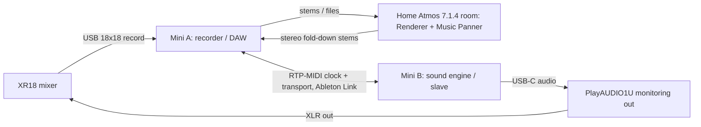

# Atmos integration

[Eugene Fight Club playback rig](../README.md)

The record-mode signal flow labels this room as a home Atmos 7.1.4 room (Renderer + Music Panner). Dock the playback case at home. Keep the existing rack at home as the record-mode hub for the XR18, patching and Atmos gear.

- Live cannot author Atmos objects or export an ADM BWF master. Use the Dolby Atmos Renderer; Live is a listed compatible DAW and needs the Dolby Atmos Music Panner.
- On macOS, Dolby Audio Bridge routes audio between Live and the Renderer on one computer (up to 128 inputs).
- Record stems at home on Mini A from the XR18 over USB (18 channels), then mix in the Renderer.
- To make backing tracks for the PlayAUDIO1U, render a stereo or binaural re-render from the Renderer, or export individual tracks from Live with Include Return and Main Effects. Export at one sample rate and load the files into the perform set.
- Dock the case at home with the front I/O panel and a single Ethernet uplink. Keep the rig's 192.168.1.x subnet separate from the home router to avoid clashes.
- Keep your existing rack at home as the record-mode hub for the XR18, patching and Atmos gear.

Mini A is the recorder / DAW. Mini B is the sound engine / slave. In record mode the XR18 USB connection is 18 in / 18 out to Mini A, the PlayAUDIO1U is monitoring out with failover not armed, and RTP-MIDI clock and transport plus Ableton Link run between the Minis. See [Modes and checklists](modes-and-checklists.md) and [RTP-MIDI setup](rtp-midi-setup.md).

The XR18 sample rate is not verified here. The PlayAUDIO1U supports 44.1, 48, 88.2 and 96 kHz; set both to the same rate after checking the XR18 manual. Export at one sample rate.

Show-network addresses stay on 192.168.1.x (Main Mini 192.168.1.11, mask 255.255.255.0, no gateway). See [Network and IP plan](network-and-ip-plan.md).

Record checklist, including backing up the session before recording:

1. Connect XR18 USB to Mini A and select it as the audio device.
2. Recall XR18 scene REC-STUDIO.
3. Load the record Audio MIDI Setup configuration; connect the RTP sessions.
4. Enable Link (and Start Stop Sync if wanted) in Live on both Minis.
5. Turn off AbleNet and failover arming.
6. Check the PlayAUDIO1U monitoring route.
7. Back up the session before recording.

XR18 scene REC-STUDIO is USB routing and studio monitors. Scene PERFORM is aux 1-5 to IEMs and main to the snake.

## Open items

- XR18 sample rate: not verified here. The PlayAUDIO1U supports 44.1, 48, 88.2 and 96 kHz; set both to the same rate after checking the XR18 manual.
- The record-mode diagram names the room a home Atmos 7.1.4 room (Renderer + Music Panner). Dock on the front I/O panel with a single Ethernet uplink, and keep 192.168.1.x separate from the home router.

## Sources

- [Dolby Atmos Renderer](https://professional.dolby.com/product/dolby-atmos-content-creation/dolby-atmos-renderer/) (Dolby)
- [XR18 user manual](https://mediadl.musictribe.com/media/PLM/data/docs/X-AIR/M_BE_0605-AAA_X-AIR_EN.pdf) (Behringer)
- [Synchronizing with Link and MIDI](https://www.ableton.com/en/live-manual/12/synchronizing-with-link-tempo-follower-and-midi/) (Ableton)
