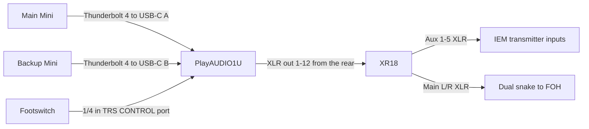

# Cable schedule

[Eugene Fight Club playback rig](../README.md)

Perform mode. The computers are confirmed Mac mini M2 (2023), not M4.

Apple lists these ports on the M2 chip: two Thunderbolt 4 (USB-C), two USB-A (up to 5 Gb/s), one HDMI (one display up to 4K60), Gigabit Ethernet (10Gb is configure-to-order and is not part of this plan), and a 3.5 mm headphone jack. The M2 drives two displays at once. See [Cases and rack layout](cases-and-rack-layout.md).

The PlayAUDIO1U's two USB-C DAW ports are on the front panel. The rear has only AC, the power switch, 12 XLR outputs and the RTP-MIDI Ethernet port. There is no rear USB. Two USB-C to USB-C cables come in the box. Keith's front USB-A host port is broken: do not use it. The PlayAUDIO1U host port is not a Mac mini port.

| From | To | Cable | Note |
| --- | --- | --- | --- |
| Main Mini Thunderbolt 4 | PlayAUDIO1U front USB-C A | USB-C to USB-C (2 in the box) | One of the two Thunderbolt ports. Computer A. Audio and MIDI. |
| Backup Mini Thunderbolt 4 | PlayAUDIO1U front USB-C B | USB-C to USB-C (2 in the box) | One of the two Thunderbolt ports. Computer B. Same session loaded. |
| Each Mini Thunderbolt 4 | USB-C KVM in the control case | USB-C (passive 2 m or active optical longer) | The other Thunderbolt port. DisplayPort over USB-C: control monitor, keyboard, and mouse. This is display 1 of 2. |
| Each Mini HDMI | 1x2 HDMI splitter, then each leg to a 2x1 HDBaseT switcher | HDMI | The only HDMI port, and display 2 of 2, up to 4K60. One picture to both projectors. Never through the KVM. Splitter price unknown. See [Video (projectors)](video-projectors.md). |
| Each Mini USB-A | RackMac front USB extension, and on the Main the Enttec | USB-A | Two USB-A ports. Sonnet's front USB 3.0 cable uses one per mini if that pass-through is plugged in. |
| Each Mini Gigabit Ethernet | Gigabit switch | Cat5e or Cat6 | AbleNet, RTP-MIDI, Lightkey, tablets. |
| PlayAUDIO1U XLR out 1-12 | XR18 inputs | XLR male to XLR male | 4U case: these leave the rear of the PlayAUDIO1U. 6U option: short jumpers to the Penn Elcom panel, then to the XR18. Suggested map below. Leave output 15 for the control tone (internal). |
| XR18 Aux 1-5 XLR | IEM transmitter inputs | XLR | One mono mix per player. |
| XR18 Main L/R XLR | Dual snake | XLR | To FOH. |
| XR18 Ethernet | Gigabit switch | Cat5e or Cat6 | Set REMOTE switch to Ethernet. |
| Wired tablets | Gigabit switch | Ethernet adapter (owned) | AbleSet web app and X AIR app. |
| Footswitch | PlayAUDIO1U CONTROL port | 1/4 in TRS | Manual failover. Configure the port in Auracle X. |
| Controller (if any) | PlayAUDIO1U 5-pin DIN MIDI in, or a Mini | MIDI DIN or USB | Do not use the PlayAUDIO1U front USB-A host port (broken). A Mini USB-A port is free for this only if the RackMac extension and the Enttec are not already using both. |
| Main Mini USB-A or switch | DMX interface or sACN node | USB or Ethernet | USB-A on the M2, not a Thunderbolt port. See [Lighting (Lightkey)](lighting-lightkey.md). |

The dual snake is assumed to carry XR18 mains and spare channels to FOH. Confirm channel count and whether it is send and return. Using a spare snake channel for DMX is a possible shortcut but was not verified; prefer a separate DMX run (see Lighting).

## Suggested output map

| Out | Suggested use |
| --- | --- |
| 1 | Click (to XR18 channel, aux sends only, not main) |
| 2 | Guide / cues (aux only) |
| 3-4 | Backing stems L/R |
| 5-6 | Drum/percussion stems L/R |
| 7-8 | Synth/bass stems L/R |
| 9-10 | FX/ambience L/R |
| 11-12 | Spare (video audio or SMPTE-style tone if needed) |

This map is a starting suggestion, not from a manual. It leaves four XR18 mic/line inputs for live sources if all 12 outputs are patched; trim it if you need more. Leave output 15 for the control tone (internal).

## Control-case USB-C runs

Passive full-featured USB-C cables are reliable at 2 m for 4K60 DP Alt Mode. For longer runs use an active optical USB-C cable: ACT lists 10 m (up to 15 m) and ADTECHNO lists 7 m and 10 m, both 4K60 DP Alt Mode. Prices unknown.

ADTECHNO marks Source and Display ends. Plug the Mini end into the Source end.

Run one extension lead from the main case's Furman to a small strip in the control case for the monitor and any KVM power.

## Audio path

Both Minis connect at once in perform mode. Main Mini to DAW A, Backup Mini to DAW B. Scene A should be the active scene.

## Open items

- Dual snake channel count, and whether it is send and return: not confirmed.
- Output map: a starting suggestion, not from a manual.
- DMX on a spare snake channel: not verified.
- Active optical USB-C prices: unknown. Cable, XLR jumper, USB-C and Cat6A prices: unknown.
- Penn Elcom USB-C and HDMI feedthroughs: unverified, and only if the 6U case is used (see [Cases and rack layout](cases-and-rack-layout.md)).
- 1x2 HDMI splitter price: unknown.

## Sources

- [PlayAUDIO1U product page](https://www.iconnectivity.com/playaudio1u) (iConnectivity)
- [PlayAUDIO1U user guide](https://www.bhphotovideo.com/lit_files/1048735.pdf) (B&H)
- [Redundant playback rig with PlayAUDIO1U](https://www.iconnectivity.com/blog/creating-a-redundant-playback-rig-with-playaudio1u) (iConnectivity)
- [ACT 10 m USB-C active optical cable](https://www.act-connectivity.com/en-us/products/cables/usb/usb-c-aoc-for-touch-panel-60w-4-lane-10m-ak4330) (ACT)
- [XR18 user manual](https://mediadl.musictribe.com/media/PLM/data/docs/X-AIR/M_BE_0605-AAA_X-AIR_EN.pdf) (Behringer)
- [Mac mini (2023) tech specs](https://support.apple.com/en-us/111837) (Apple)
- [How many displays on Mac mini (2023) with M2](https://support.apple.com/en-us/148273) (Apple)
- [RackMac mini specs](https://www.sonnettech.com/product/rackmacmini.html) (Sonnet)
