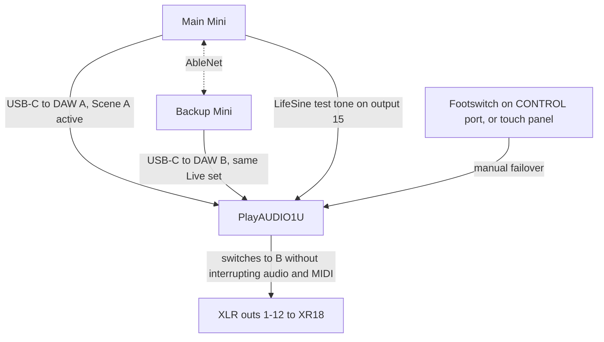

# Cases and rack layout

[Eugene Fight Club playback rig](../README.md)

Keith wants more mobile than his current rack. The build below uses three pieces: a main case, a stage case and a control case. His existing rack stays home as the record-mode hub.

M1 confirmed: two identical Mac mini (M1, Late 2020) units, each 16GB unified memory and 512GB SSD. Apple's tech specs list that computer at 1.4 in (3.6 cm) tall, 7.7 in (19.7 cm) square, and 2.6 lb (1.2 kg). 1U is 1.75 in (44.45 mm), so the chassis fits a 1U rack. 16GB memory and a 512GB SSD are configure-to-order options on that page (the base model is 8GB and 256GB).

## PlayAUDIO1U setup

| | |
| --- | --- |
| Outputs | 12 balanced XLR line outs, 24-bit up to 96 kHz, plus a stereo headphone output with two independent mixes |
| Computer ports | Two USB-C DAW ports (A and B), front panel |
| MIDI | 5-pin DIN in and out (front), USB host for up to 8 devices (front, broken on Keith's unit), Ethernet RTP-MIDI (rear) |
| Control | Two footswitch CONTROL ports (front), mappable to MIDI functions and failover |
| Size | 1U, 19 in wide, 7.81 in deep, 8.73 lb per the manual; IEC power, 24 W |
| Failover | Automatic via a test tone on output 15, plus manual via touch panel or footswitch |

The PlayAUDIO1U manual lists its two USB-C DAW ports and USB host port on the front panel. The rear has only AC, power switch, 12 XLR outputs and the RTP-MIDI Ethernet port. There is no rear USB.

The PlayAUDIO1U supports 44.1, 48, 88.2 and 96 kHz. The XR18 sample rate is not verified here; set both to the same rate after checking the XR18 manual.

Keith's front USB-A host port is broken, so the controller must come in over the 5-pin DIN MIDI input, the Ethernet RTP-MIDI port, a footswitch on the Control ports, or AbleSet on a wired tablet.

1. **Cable both Minis to the front USB-C ports.** Main Mini to DAW A, Backup Mini to DAW B. Scene A should be the active scene.
2. **Load the same Live set on both.** Route tracks to identical outputs on both computers, as iConnectivity's redundancy guide says.
3. **Arm automatic failover.** On the Main Mini, add iConnectivity's free LifeSine plugin on a track and set its output to output 15. A blinking shield icon on the display means it is armed.
4. **Test it.** Start playback on both, then pull the USB cable from DAW A. The PlayAUDIO1U should switch to B without interrupting audio and MIDI.
5. **Add a footswitch for manual failover.** Assign the failover function to a CONTROL port in Auracle X.
6. **Give controllers another path.** The host port is damaged, so use DIN MIDI in, RTP-MIDI over Ethernet, or AbleSet on tablets.

Suggested output map (a starting suggestion, not from a manual): see [Cable schedule](cable-schedule.md). It leaves output 15 for the control tone (internal).

### Failover path

## Mac mini mount

Both minis go in a Sonnet RackMac mini, part RACK-MIN-2XA. Sonnet's store title is RackMac mini (2018–2023), $249.99, in stock on Nov 26, 2026. The product page says it holds one or two Mac minis side by side in 1U. Sonnet's support note says RACK-MIN-2XA is fully compatible with M1 Mac minis. Dimensions are 19 x 8.4 x 1.7 in (48.3 x 21.3 x 4.4 cm). Sonnet also lists an 8.25 in mounting depth and a weight of 5.8 lb (2.63 kg). The rear is open for the computer ports. Each bay has a front power button and a front USB 3.0 port, with a panel cable to one USB-A port on that mini. The 1.4 in M1 chassis fits this 1U mount, so the Gator GR-4S layout stays.

## Recommended main case: 4U

The mount is 1U, so the racked gear is four units: power, PlayAUDIO1U, switch, and the Sonnet. Gator says the GR Shallow series is 2U, 3U, 4U, and 6U, so there is no GR-5S to keep a fifth unit. The main case is the Gator GR-4S.

| RU | Gear | Depth note | Notes |
| --- | --- | --- | --- |
| 1 | Furman M-8x2 power conditioner | 3.75 in | 8 rear outlets, 15 A, rear IEC-style cord; powers everything in the case |
| 2 | PlayAUDIO1U | 7.81 in plus XLR plugs | No front I/O panel in this 4U case. XLRs leave the rear. |
| 3 | TL-SG1016D switch | 7.1 in, 13 in wide | Listed as 13 in rackmountable; confirm 19 in ears or use a shelf |
| 4 | Sonnet RackMac mini RACK-MIN-2XA | 8.4 in deep, 8.25 in mounting depth | Both M1 minis, side by side |

Gator lists the GR-4S at $249.99, 11 lb, and calls it a shallow 14.25 in case. The same page lists an interior length of 12.25 in. The Sonnet enclosure fits that depth. Depth of the PlayAUDIO1U plus XLR plugs is still the limit. The rolling alternative is the SKB 1SKB-R4SW (20.2 lb, $269.99), with the same PlayAUDIO1U-plus-XLR depth limit.

## 6U if the front I/O panel stays

A 1U Penn Elcom D-series panel does not fit in the 4U case. Gator has no 5U in the GR Shallow series. Keeping the panel means the Gator GR-6S (6U, 14.25 in rack depth, 13 lb empty, $259.99) with 1U empty.

| RU | Gear | Depth note | Notes |
| --- | --- | --- | --- |
| 1 | Furman M-8x2 power conditioner | 3.75 in | 8 rear outlets, 15 A, rear IEC-style cord; powers everything in the case |
| 2 | 1U front I/O panel (Penn Elcom, D-series) | Panel | Front XLR, Ethercon and pass-through jacks so setup is a few cables; USB-C and HDMI feedthroughs unverified |
| 3 | PlayAUDIO1U | 7.81 in plus XLR plugs | Rear XLRs go to the I/O panel with short jumpers |
| 4 | TL-SG1016D switch | 7.1 in, 13 in wide | Listed as 13 in rackmountable; confirm 19 in ears or use a shelf |
| 5 | Sonnet RackMac mini RACK-MIN-2XA | 8.4 in deep | Both M1 minis |
| 6 | Empty | | No 5U GR shallow case, so this space stays open |

The SKB 1SKB-R6SW rolls but has only 11.75 in rail depth and weighs 29.48 lb empty, which is tight with PlayAUDIO1U cabling. The Penn Elcom panel is $20.16. GR-6S is $10.00 more than GR-4S.

## Stage case and weights

Retailers list the XR18 as a 3U rackmount that ships with rack ears, so it does not need a rack kit to be racked. Its listed 333 mm width with ears is narrower than a 19 in panel, so check fit before buying 19 in third-party ears ($17.99 to $24.59).

- XR18: 3U, 7.1 lb (3.2 kg), 30 W. Rack it with its ears in a Gator GR-3S (3U, 14.25 in, $239.99) or leave it on a stand as a stage box.
- IEM transmitters: ride in the stage case or on the XR18 lid. Five Shure P3T half-racks need 3U with RPW504 kits; five Xvive U4 transmitters need none.
- Weights I can verify: Gator GR-4S 11 lb, GR-6S 13 lb, SKB R4SW 20.2 lb, R6SW 29.48 lb, R8SW 31 lb, PlayAUDIO1U 8.73 lb, XR18 7.1 lb, Sonnet RackMac mini 5.8 lb, each M1 mini 2.6 lb (1.2 kg). Apple notes that weight varies by configuration. Other gear weights are unknown.
- Setup-time tips: the 4U case has no front I/O panel, so label the rear XLR loom from the PlayAUDIO1U. The 6U option can stay fully cabled to that panel. Label cables; keep all static IPs on a laminated card; pre-load Audio MIDI Setup configs per mode.

## Compact KVM options compared

The chosen approach is a two-USB-C KVM plus a portable monitor, carried in the separate control case. A 1U rack LCD drawer does not fit a shallow case.

**Two-USB-C KVM plus portable monitor (chosen)**

- $99.99 to $179.95 for the KVM and about $100 for the monitor
- Light and easy to carry in a separate case
- One USB-C cable per Mini

**1U rack LCD drawer**

- Black Box KVT617A costs $1,392 to $1,754.55 and is 20.7 in deep
- A 17 in HDMI drawer from kvmswitchtech is $1,200 and about 25.6 in deep
- Neither fits a shallow case

## Control case

The control case is carried separately: a 15.6 in portable monitor, a two-port USB-C KVM and a wired compact keyboard and mouse, linked to each Mini by one USB-C cable.

| Part | Pick | Price | Notes |
| --- | --- | --- | --- |
| USB-C KVM (budget) | Sabrent USB-KCPD | $99.99 | Two USB-C DP Alt Mode inputs, HDMI 2.0 out 4K60, macOS 10.10+, 1 m cables, toggles between hosts (no simultaneous control) |
| USB-C KVM (better) | IOGEAR GCS1602CCKIT | $179.95 | Two USB-C hosts, DP/HDMI out, 4K60, Mac OS X 10.12+, push-button remote, includes two USB-C cables and DP to HDMI adapter |
| Monitor | ASUS ZenScreen MB16AHV | $99.99 Amazon, $139.99 elsewhere | 15.6 in 1080p, USB-C (15W PD) and mini-HDMI, 0.9 kg |
| Keyboard and mouse | Compact wired USB keyboard and mouse | Unknown | Bluetooth will not pass through the KVM |
| Case | Pelican 1490CC1 laptop case | $299.95 | Interior 17.75 x 11.37 x 4.12 in, 6.5 lb with foam, handle and shoulder strap |
| Lighter case | Padded laptop or gig bag | Unknown | Cheapest and lightest if no crush protection is needed |

1. **Cable lengths.** Passive full-featured USB-C cables are reliable at 2 m for 4K60 DP Alt Mode. For longer runs use an active optical USB-C cable: ACT lists 10 m (up to 15 m) and ADTECHNO lists 7 m and 10 m, both 4K60 DP Alt Mode. Prices unknown.
2. **Direction matters on some optical cables.** ADTECHNO marks Source and Display ends. Plug the Mini end into the Source end.
3. **Power.** Run one extension lead from the main case's Furman to a small strip in the control case for the monitor and any KVM power.
4. **Mini port budget.** Each confirmed M1 has two Thunderbolt / USB 4 ports (DisplayPort, Thunderbolt 3 up to 40 Gb/s, USB 4, USB 3.1 Gen 2 up to 10 Gb/s), two USB-A ports (up to 5 Gb/s), one HDMI 2.0 port, Gigabit Ethernet, and a 3.5 mm headphone jack. Apple's current tech specs say it supports two displays at once: one up to 6K at 60Hz over Thunderbolt and one up to 4K at 60Hz over HDMI. Apple's 2020 specifications call that port HDMI 2.0. One Thunderbolt / USB 4 port goes to the USB-C KVM (native DisplayPort over USB-C). That is the Thunderbolt display. The other Thunderbolt / USB 4 port goes to the PlayAUDIO1U and is not a second display. HDMI 2.0 is the projector output, at up to 4K60, and a 1x2 splitter feeds both switchers. The 3.5 mm jack is unused in this wiring. Gigabit Ethernet goes to the switch. 10Gb Ethernet is a configure-to-order option and is not part of these units.
5. **Hotkey and monitoring.** These USB-C KVMs use a button or remote. Keep the monitor on the Backup Mini during the first song to confirm it tracks the Main.

## Open items

- M1 confirmed: two identical Mac mini (M1, Late 2020) units, 16GB / 512GB.
- TL-SG1016D: listed as 13 in rackmountable; confirm 19 in ears or use a shelf.
- Penn Elcom panel, only if the 6U case is used: USB-C and HDMI feedthroughs unverified.
- 1x2 HDMI splitter: no price found. It is part of the cable line, which is Unknown.
- Other gear weights are unknown.
- Keyboard and mouse price: unknown. Padded laptop or gig bag price: unknown.
- Active optical USB-C cable prices: unknown.
- XR18 third-party 19 in ears: check fit. Listed width with ears is 333 mm, narrower than a 19 in panel.

## Sources

- [PlayAUDIO1U product page](https://www.iconnectivity.com/playaudio1u) (iConnectivity)
- [PlayAUDIO1U user guide](https://www.bhphotovideo.com/lit_files/1048735.pdf) (B&H)
- [Redundant playback rig with PlayAUDIO1U](https://www.iconnectivity.com/blog/creating-a-redundant-playback-rig-with-playaudio1u) (iConnectivity)
- [Sonnet RackMac mini (2018–2023) store](https://www.sonnetstore.com/products/rackmac-mini) (Sonnet)
- [RackMac mini specs](https://www.sonnettech.com/product/rackmacmini.html) (Sonnet)
- [Furman M-8x2](https://www.guitarcenter.com/Furman/M-8X2-Power-Conditioner-1273888005042.gc) (Guitar Center)
- [TL-SG1016D](https://www.microcenter.com/product/715627/tp-link-tl-sg1016d-16-port-gigabit-desktop-rackmount-switch) (Micro Center)
- [Gator GR-4S](https://gatorco.com/product/4u-audio-rack-shallow-gr-4s/) (Gator)
- [Gator GR-6S](https://gatorco.com/product/6u-audio-rack-shallow-gr-6s/) (Gator)
- [SKB 1SKB-R6SW](https://www.ggvideo.com/skb_rseries-6u-shallow-rolling-rack.php) (G&G)
- [SKB 1SKB-R4SW](https://www.ggvideo.com/skb_rseries-4u-shallow-rolling-rack.php) (G&G)
- [Penn Elcom 1U D-series panel](https://www.penn-elcom.com/us/1u-rack-panels-punched-for-12-x-d-series-connectors-r1269-1uk-12) (Penn Elcom)
- [XR18 specs (3U, rack ears)](https://www.thomannmusic.com/behringer_x_air_xr18.htm) (Thomann)
- [Sabrent 2-port USB-C KVM](https://sabrent.com/products/usb-kcpd) (Sabrent)
- [IOGEAR GCS1602CCKIT](https://iogear.com/products/gcs1602cckit) (IOGEAR)
- [ASUS ZenScreen MB16AHV](https://www.amazon.com/ASUS-ZenScreen-viewable-Portable-MB16AHV/dp/B0CGGLZ8YT) (Amazon)
- [Pelican 1490CC1](https://www.pelican.com/us/en/product/cases/1490cc1) (Pelican)
- [ACT 10 m USB-C active optical cable](https://www.act-connectivity.com/en-us/products/cables/usb/usb-c-aoc-for-touch-panel-60w-4-lane-10m-ak4330) (ACT)
- [Mac mini (M1, 2020) tech specs](https://support.apple.com/en-us/111894) (Apple)
- [Mac mini technical specifications, January 2021 (HDMI 2.0)](https://web.archive.org/web/20210126073214/https://www.apple.com/mac-mini/specs/) (Apple)
- [RackMac mini M1 compatibility](https://www.sonnettech.com/support/kb/kb.php?action=b1151&cat=435&expand=_a2_b1035_b649_a13_a1) (Sonnet)
