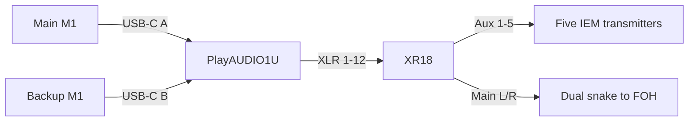
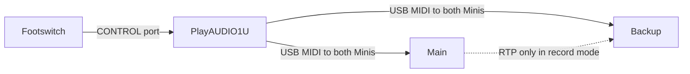
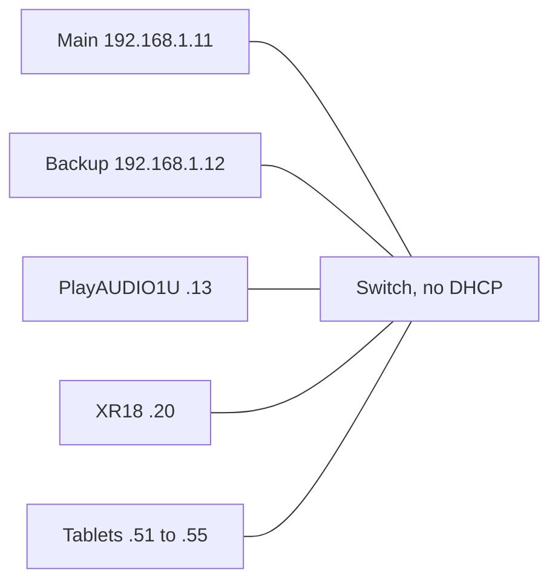
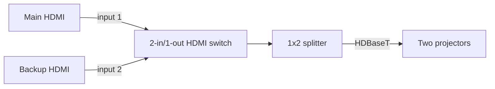

# 02. Signal flow

[Start here](00-start-here.md)

## Audio

Output 15 is the LifeSine tone and is not patched. [Cable schedule](../cable-schedule.md).

## MIDI

Perform mode keeps Mini-to-Mini RTP off or unrouted. [RTP-MIDI setup](../rtp-midi-setup.md).

## Network

[Network plan](../network-and-ip-plan.md).

## Video

A 2x2 matrix can replace the switch-plus-splitter if each screen must be picked alone. No model is chosen. [Video](../video-projectors.md).

## Lighting

[Lighting](../lighting-lightkey.md).

## Power

The Furman M-8x2 feeds the main case. One extension lead from the Furman feeds a small strip in the control case. The plan does not publish a manufacturer power-on order. The [show-day runbook](../../SHOW-DAY-RUNBOOK.md) uses Furman, switch, PlayAUDIO1U, Minis, XR18, IEMs, then control and projectors, and says that sequence is unverified as a manual.
