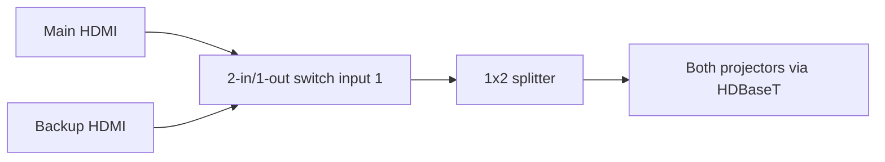

# 06. Lighting and video

[Start here](00-start-here.md)

## Lighting

Lightkey runs on the Main Mini. The Enttec DMX USB Pro Mk2 uses a USB-A port. The Sonnet front-panel USB lead also wants one USB-A if you plug it in. The M1 has two USB-A ports. [Lighting](../lighting-lightkey.md). [Apple ports](https://support.apple.com/en-us/111894).

Live Triggers drag cues onto the Live timeline on that same Mac. [Lightkey specs](https://www.lightkeyapp.com/en/specs). They do not need RTP between the Minis.

One license, one Mac. A second license is the only way both Minis output DMX. The plan says to buy the second only if you need lighting redundancy. A network node on `192.168.1.30` is optional for Art-Net or sACN.

Use a dedicated DMX cable. A spare snake channel was not verified.

## Video

Each M1: KVM on one Thunderbolt / USB 4 port, PlayAUDIO1U on the other, HDMI 2.0 to the show.

A 2x2 HDMI matrix is the alternative. No model or price. [Video](../video-projectors.md).

AbleSet Pro OSC Tracks can start cues in an external player. AbleSet itself does not play the movie. [ableset.md](../ableset.md).

Live’s video window hides when Live is not the focused app. Do not expect the KVM focus change to keep a native Live video window on screen. [Video](../video-projectors.md).
