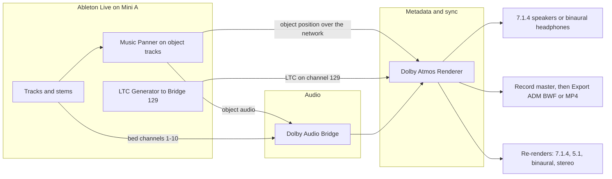

# 11. Dolby Atmos workflow

[Start here](00-start-here.md)

This is the home-studio mixing page, not the show-day playback path. The record-mode diagram already names a home Atmos 7.1.4 room. [Home Atmos studio](10-home-atmos-studio.md). [Atmos integration](../atmos-integration.md).

## Short answer

Yes, the mix can change when you leave a 7.1.4 speaker mix in Ableton Live and open it in the Dolby Atmos Renderer. Live does not author Atmos objects or write an ADM BWF master. A 7.1.4 mix in Live is twelve channel-based outputs. The Renderer only keeps that placement if those channels are mapped as a legal Atmos bed plus objects (or as objects pinned to the speaker positions), and if you then record and export from the Renderer with the intended monitoring layout, trim and downmix, and binaural settings.

To render the placement and mix: route Live into the Renderer over Dolby Audio Bridge, put the Dolby Atmos Music Panner on object tracks so position metadata reaches the Renderer, lock the two apps together with LTC, record a Dolby Atmos master, then export ADM BWF (and MP4 if you need it). You do not have to use the Renderer app. Fiedler Audio’s Dolby Atmos Composer is a Dolby-approved plug-in path that keeps the renderer inside Live and exports ADM BWF from the session.

A 5.1 re-render will not keep height placements. There are no height speakers in 5.1, so overhead energy folds into the floor. See [Folding down to 5.1 loses my placements](#folding-down-to-51-loses-my-placements).

## Why a 7.1.4 mix in Live is not yet an Atmos mix

Ableton Live 12 can address many output channels and can run VST3 or AU plug-ins. [Routing and I/O](https://www.ableton.com/en/live-manual/12/routing-and-i-o/). It has no native Atmos object metadata, no built-in Atmos renderer, and no ADM BWF export. Dolby lists Live as a compatible DAW only with the Dolby Atmos Music Panner. [Renderer](https://professional.dolby.com/product/dolby-atmos-content-creation/dolby-atmos-renderer/). [Music Panner](https://professional.dolby.com/product/dolby-atmos-content-creation/dolby-atmos-music-panner).

Live 13 is announced for early 2027. The public “What’s new” list and the 13.0b27 beta notes (25 November 2026) do not add native Atmos. [Live 13](https://www.ableton.com/en/live/). [Live 13 beta notes](https://www.ableton.com/en/release-notes/live-13-beta/).

Live’s included Surround Panner is a Max for Live device for 4-, 6-, and 8-channel two-dimensional speaker layouts. It is not a 7.1.4 height panner and it is not Atmos. [Surround Panner](https://www.ableton.com/en/packs/surround-panner/).

An Atmos master is a bed plus objects, with metadata, in an ADM BWF file (or a Dolby Atmos master that you then export). Beds are channel-based and, in Dolby Atmos, go up to 7.1.2 (ten channels). There is no 7.1.4 bed. Height beyond that bed is carried as objects. [Dolby Hybrik: beds up to 7.1.2, then objects](https://docs.hybrik.com/tutorials/dolby_atmos/). [Dolby Atmos Music Delivery Playbook](https://www.dolby.com/siteassets/dolby-creator-lab/dolby-atmos-music-accelerator/dolby-atmos-music-delivery-playbook-1.pdf) (June 2024): up to 128 channels, “10 beds and 118 objects,” 24-bit PCM at 48 kHz, 24 fps.

If you only send twelve Live outputs into the Renderer and do not map the four 7.1.4 heights as objects, two height channels have no bed slot. Placement will not match what you heard in Live.

## Signal flow

Audio, position metadata, and timecode are three separate connections. Meters can move while metadata or LTC is missing. In that case objects will not move, or the recorded master will drift.

The Fiedler path has no Audio Bridge and no LTC. Beam plug-ins send audio and panning into the Composer plug-in on a bus or master track. Composer’s built-in renderer monitors and writes the ADM. [Fiedler Composer](https://fiedler-audio.com/dolby-atmos-composer/).

## What can change when you open the Renderer

- **Channel layout versus Atmos layout.** A 7.1.4 speaker mix has four height channels. A 7.1.2 bed only has two (left and right top surround, typically mid-side overhead, not the front and rear height pairs of a 7.1.4 room).
- **Objects versus a static bed.** A bed channel goes to its matching speaker, then folds if that speaker is missing. An object is rendered from XYZ metadata for the current speaker layout. Re-panning sources as objects will not match a static 7.1.4 bounce unless you pin those objects to the same speaker positions.
- **The Renderer’s monitoring layout.** The Renderer renders to the selected layout (for example 7.1.4, 7.1, 5.1, 2.0, or binaural), not to whatever you were hearing as discrete Live outputs. [Renderer guide, room and monitoring layouts](https://professional.dolby.com/siteassets/content-creation/dolby-atmos/dolby_atmos_renderer_guide.pdf).
- **Binaural render modes.** Off, Near, Mid, or Far on each bed channel and object. UMG’s best practices, following Dolby, say this affects the headphone / binaural render, not speaker processing. [UMG Dolby Atmos best practices](https://contentguide.universalmusic.com/dolby-atmos-audio-best-practices/).
- **LFE and bass management.** Full-range signal should not be printed to LFE. Music delivery practice is a low-pass in the 100–150 Hz range on LFE sends. The LFE is an extension, not the only bass in the mix.
- **Trim and downmix.** These settings change 5.1, 7.1, and stereo re-renders and are stored in the ADM for playback devices. They are why a 5.1 fold can also change level and front/back balance, even after heights have already been collapsed to the floor.

## Keeping a 7.1.4 speaker mix intact

Use one of these mappings. Do not pour twelve channels into a 7.1.2 bed.

1. **7.1 bed plus four height objects (preferred for a static 7.1.4 speaker mix).** Route L, R, C, LFE, Lss, Rss, Lrs, and Rrs to bed inputs 1–8. Route the four height channels (typically Ltf, Rtf, Ltr, Rtr) to four object inputs, for example 11–14. On each height object, insert the Music Panner, set the object number to match the output, and pin the object to that height speaker. Fiedler documents the same split: a 7.1.4 composite is “a 7.1 bed and the four height channels as dynamic objects.” [Fiedler Composer manual](https://fiedler-audio.com/?wpdmdl=7957).
2. **7.1.2 bed plus two extra height objects.** Only use this if you deliberately want the bed’s two top-surround channels at mid-side overhead, plus two objects for the remaining height speakers. That is not the same as four 7.1.4 corner heights.
3. **All twelve channels as objects pinned to speaker positions.** Legal, and useful if you want no bed. You spend twelve of the 118 object slots.
4. **Re-pan the sources as objects** with the Music Panner (or Fiedler Beam) instead of printing a static 7.1.4 bus. That is a new object mix. It will not be identical to the channel bounce unless you pin everything back to the same speakers.

Then monitor in the Renderer (or in Composer) on the 7.1.4 layout, record the master, and export ADM BWF. The export, not the Live session alone, is the Atmos mix.

## Folding down to 5.1 loses my placements

A 5.1 re-render has no height speakers. Overhead bed channels and elevated objects are folded into the floor speakers. Elevation as a placement cannot survive. Apple’s Logic Pro documentation of the same Dolby trim and downmix metadata says the renderer must “fold down the immersive mix” to a layout “that doesn’t have height channels (for example, 7.1 or 5.1).” Those settings are stored in the ADM BWF and used by Dolby Atmos playback devices. [Downmix and trim controls in Logic Pro](https://support.apple.com/en-gb/guide/logicpro/lgcp8118444e/mac). In the Renderer, open **Window > Trim and Downmix Controls**. [HHB, quoting Dolby’s Music Panner documentation](https://www.hhb.co.uk/wp-content/uploads/Using-the-Dolby-Atmos-Music-Panner-Final.pdf).

7.1 side and rear pairs also collapse. In the default Lo/Ro path, the mix is rendered to 7.1 and then downmixed to 5.1 with Ls = Lss + Lrs and Rs = Rss + Rrs at 0 dB. Side-versus-rear placement in 7.1 is no longer separate. [Logic Pro downmix algorithms](https://support.apple.com/en-gb/guide/logicpro/lgcp8118444e/mac).

### Trim and downmix controls

Trims are applied before the downmix. For each target layout (including 5.1 and 2.0, 5.1.2, 5.1.4, and 7.1):

- **Automatic** uses the Renderer’s default trim and balance values. The sliders are dimmed.
- **Manual** lets you set them.
- **Surround trim** lowers surround-channel level in the downmix.
- **Height / overhead trim** lowers height-channel level in the downmix.
- **Overhead balance** shifts remaining height energy forward or back.
- **Listener plane balance** shifts ear-level energy forward or back. Center (0%) leaves that balance unchanged.

UMG, and Dolby’s music panner documentation as quoted by HHB, recommend **Manual** trims at **0 dB** and **0%** balance for music, and **Direct Render** for 5.1 and 5.1.x, because it renders straight to 5.1 instead of going through 7.1 first. [UMG](https://contentguide.universalmusic.com/dolby-atmos-audio-best-practices/). [HHB](https://www.hhb.co.uk/wp-content/uploads/Using-the-Dolby-Atmos-Music-Panner-Final.pdf). Ceri Thomas, who set Dolby Music creation standards, still suggests listening: Automatic is a generic energy fold, and a small surround trim (he often prefers about −1.5 dB rather than 0 dB) can keep the 5.1 from getting louder simply because fewer speakers now play the same energy. [Trim and Downmix, parts one and two](https://www.immersivemasterpro.com/news-articles/trimanddownmixpartone).

### Lo/Ro, Lt/Rt, and Direct Render

For 5.1 and 5.1.x, the usual choices are:

- **Lo/Ro – default.** Left only / Right only. Render to 7.1, then fold to 5.1 by summing sides and rears as above. The later stereo stage from that 5.1 is a discrete, non-matrixed Lo/Ro downmix.
- **Dolby Pro Logic IIx.** A matrixed 7.1-to-5.1 fold with cross-feed and attenuation on the rears.
- **Direct render.** Render the Atmos mix straight to 5.1, aimed at the central listening position with phantom images between front and surround speakers. This is the usual music recommendation.
- **Direct render with room balance.** Also renders straight to 5.1, with extra handling for signals between the midpoint and the back of the room. More of a post / theatrical tool.

For 5.1 to 2.0, **Lo/Ro** adds center and surrounds into L and R at reduced level and ignores LFE. **Lt/Rt** (Left total / Right total) is a matrixed stereo fold, including a Pro Logic II option with a 90° phase shift. Use Lo/Ro unless a client asks for a matrixed Lt/Rt.

Apple notes that **Stereo Direct** is a monitoring re-render, not a downmix setting written into the master. Ceri Thomas says the same: an encoder cannot use Stereo Direct as the ADM’s 2.0. You can still bounce it as a separate WAV. [Part two](https://www.immersivemasterpro.com/news-articles/trimanddownmixparttwo).

### Object zones and snap

Atmos object metadata can include **speaker snap** (the object jumps to the nearest speaker) and **zone control** (the object is kept out of some speaker groups, such as sides, rears, or overheads). [SMPTE RDD 29:2019](https://pub.smpte.org/pub/rdd29/rdd29-2019.pdf). Nuendo’s VST MultiPanner documents both. [Nuendo object mode](https://www.steinberg.help/r/nuendo/15.0/en/cubase_nuendo/topics/surround_sound/surround_sound_dolby_atmos_vst_multipanner_object_mode_r.html).

I could not verify that the Dolby Atmos Music Panner exposes snap or zone controls. If a master already has them, they change the 5.1 fold: snap will choose a floor speaker when no height speaker exists, and a zone that excludes floor speakers can drop or relocate the object unhelpfully.

### Binaural is a different path

Binaural render modes are for headphones, not the 5.1 speaker downmix. Do not judge a 5.1 fold by listening only to the binaural output. The full headphone path, including Apple Music Spatial Audio, is in [Binaural and headphone mixing](#binaural-and-headphone-mixing).

### What can stay readable, and what cannot

Can stay readable: left/right and front/back on the floor, if you monitor the 5.1 re-render and use Direct Render, then trim only as much as the fold needs. Important musical parts should already have a floor image, not only a height image.

Cannot survive: discrete height placement; a 7.1 distinction between side and rear surrounds under Lo/Ro; object paths that only made sense in elevation; a snap-to-overhead-speaker cue when the 5.1 layout has no overhead speaker.

### Practical steps

1. In the Renderer, add a 5.1 re-render and listen to it while you mix, not only after export. Switch the monitoring layout to 5.1. [Renderer guide, custom monitoring layouts](https://professional.dolby.com/siteassets/content-creation/dolby-atmos/dolby_atmos_renderer_guide.pdf).
2. Set 5.1 downmix to Direct Render. Start Manual trims at 0 dB / 0%, then trim height or surrounds if the floor gets crowded or loud.
3. Keep lead elements on the floor (or as objects that still image in 5.1). Use heights for space, motion, or doubles, not as the only home for a hook.
4. Check that object zones, if you have them, do not exclude the floor speakers you need in 5.1.
5. A/B 7.1.4, 5.1, 2.0, and binaural. Export the 5.1 and binaural re-renders as WAVs if you need to check them away from the Renderer.
6. If a placement only works in 7.1.4, it will not “fix itself” in the 5.1 fold. Change the object path or add a floor element.

## Automating object movement in Ableton

Live stores the moves as ordinary plug-in automation. The Atmos file stores them as object position metadata. Those are not the same step.

### In Live, for either plug-in

Practically all device controls can be automated. In Arrangement View the data lives in automation lanes as breakpoint envelopes. You can record it or draw it. [Live 12, Automation](https://www.ableton.com/en/live-manual/12/automation/).

1. Show the plug-in’s parameters in Live’s panel. For a plug-in with more than 64 parameters, the panel starts empty. Click **Configure** in the device header, then click (or, for some plug-ins, move) the control in the plug-in window to add it. Some parameters are never published to the host and cannot be added. Save a Rack if you want the same parameter set later. [Live 12, Using Plug-Ins](https://www.ableton.com/en/live-manual/12/using-plug-ins/).
2. To record moves in Arrangement View, enable the Control Bar’s **Automation Arm** button, click **Arrangement Record**, and move the panner controls (or a mapped MIDI controller). Stop Arrangement Record when you are done. The moves appear in the track’s automation lanes.
3. To draw or edit without recording, enable Automation Mode, open the track’s automation lane, and choose the device and parameter from the choosers. Edit the breakpoint envelope. You can also record automation into Session clips, then copy those clips into the Arrangement; the envelopes become track automation.

A colored LED on a parameter means it is automated. If you move an automated control during playback without recording, Live overrides the envelope until you re-enable it.

### Music Panner and the Renderer

The Music Panner’s basic controls are **X**, **Y**, **Z**, and **Size**, plus elevation modes (manual / freeform, and modes such as wedge, dome or ceiling / the official quick-start also names sphere and curve). Size is the object’s apparent size, shown as a halo, not stereo width. [HHB Music Panner article](https://www.hhb.co.uk/wp-content/uploads/Using-the-Dolby-Atmos-Music-Panner-Final.pdf). [Dolby Atmos Music Panner quick start](https://www.youtube.com/watch?v=Qe66zlWOlSs). Dolby’s v5.4.0 user guide has a page titled “Dolby Atmos Music Panner automatable controls.” This environment could not read that page as text, so treat X, Y, Z, Size, elevation, linking, and the sequencer as the publicly documented set, and confirm any other names in the installed plug-in.

The Panner does not print Atmos metadata into the audio stream. It sends position metadata to the Renderer over the network (localhost on one Mac). Live’s automation only becomes an Atmos move if the Renderer is connected, the object number matches the track output, and you **record a master in the Renderer** while Live plays. Use the Dolby LTC Generator on a track routed to Dolby Audio Bridge channel 129, set the Renderer to external sync from LTC over audio, and turn Sync on. Then use Record In/Out (or the record button) on the Renderer and play the session. [Netflix branded BWAV ADM guidelines](https://studiopartner.netflix.net/studio/branded-bwav-adm-creation-guidelines). [Sam Ryan’s Live setup, including LTC on 129](https://www.samryan.ca/post/getting-started-with-dolby-atmos-in-ableton-live).

If LTC is off or unlocked, you can still hear objects move while you play, but the recorded master can drift or start at the wrong time. After the .atmos recording, export ADM BWF. That file holds the object positions over time. [SMPTE RDD 29:2019](https://pub.smpte.org/pub/rdd29/rdd29-2019.pdf) describes object positions updating on a short interval (about 20 ms).

If the Music Panner **sequencer** is on, it ignores previously set X/Y pan settings and keeps size and elevation. Do not fight the sequencer with X/Y automation. Use one or the other. See the [FAQ](#why-does-the-panner-sequencer-only-do-mono).

Binaural render mode is not automatable and cannot change during a session. [UMG](https://contentguide.universalmusic.com/dolby-atmos-audio-best-practices/).

### Fiedler Beam and Composer

Put **Dolby Atmos Beam** (or Beam Essential) on the source tracks and **Dolby Atmos Composer** on a bus or master that receives the mix. Beam’s position controls are polar: **Azimuth**, **Elevation**, and **Distance**, plus global **Spread** and **Volume**. Pan Mode can be Composite (bed-like) or Objects (converted to Dolby’s cubic object coordinates). [Fiedler Composer manual](https://fiedler-audio.com/?wpdmdl=7957).

Fiedler recommends post-fader inserts so pan and volume automation are included in the Atmos mix. It lists that feature on Cubase, Nuendo, Ardour, Mixbus, and Digital Performer 11, not on Live. In Live, automate Beam’s own Volume and position knobs if you need those moves in the Atmos export. The track fader alone may not be in the path Beam sends to Composer.

For ordinary Beam knobs, use Live’s Configure Mode and automation lanes the same way as the Music Panner. Sound on Sound describes enabling plug-in automation and editing Beam’s controls in the DAW’s automation lanes. [SOS review](https://www.soundonsound.com/reviews/fiedler-audio-dolby-atmos-composer).

Composer’s **Master Channel** (full version) uses “dynamic automation” for OBAM plug-ins. Assign a parameter to a Composer automation lane first. Then, in Live: unfold the Composer device (triangle), click **Configure**, touch the assigned control in the OBAM editor so it appears in Live’s parameter list, and turn Configure off. [Fiedler manual, Ableton Live](https://fiedler-audio.com/?wpdmdl=7957). Ignore any parameter named **DO NOT USE**.

Composer writes the ADM itself. Set in and out points in Composer, click Export, choose a folder, and then play or offline-export that same range from Live, starting at or slightly before the in point and running past the out point. No LTC and no separate Renderer recording step. If Live stops processing when clips end, the export may not finish; keep processing on through the out point. You can delete any WAV Live itself wrote; the ADM comes from Composer.

## Do I have to use the Dolby Atmos Renderer?

No. You need a Dolby-approved renderer *somewhere* if the deliverable is an Atmos ADM. It does not have to be the standalone Dolby Atmos Renderer app.

### (a) Dolby Atmos Renderer app, Audio Bridge, and Music Panner

This is Dolby’s qualified Live path. Music Panner is free (AAX, AU, VST3, Mac) and requires Renderer v5.0 or later. [Music Panner](https://professional.dolby.com/product/dolby-atmos-content-creation/dolby-atmos-music-panner). The Renderer was $299 on the [Dolby Professional Store](https://professionalstore.dolby.com/product/dolby-atmos-renderer/01tQQ00000JfoPJYAZ) when that page was checked on 26 November 2026. Older Pro Tools promotional pricing has existed; check the store at purchase time. Dolby Audio Bridge (macOS only) carries up to 128 channels on one computer. You handle routing, object numbers, LTC, a real-time master record, trim and downmix, re-renders, and ADM or MP4 export in the Renderer. This is the path the rest of the setup steps below describe.

Public Renderer documentation on Dolby’s customer site is for **v5.4.0**. Trade coverage also reported **v5.5.0** in August 2026 (Music Panner sequencer in AU and VST3 DAWs, input and speaker solo/mute, AC-4 L3 MP4). [Hispasonic on v5.5.0](https://www.hispasonic.com/noticias/dolby-atmos-renderer-v550-disponible/49201). Use the installer notes on your machine for the exact menu names.

### (b) Fiedler Audio Dolby Atmos Composer

A Dolby-approved plug-in with the renderer built in. It runs in Live (VST3, AU, AAX; Apple Silicon). Official Ableton session templates exist. [Composer](https://fiedler-audio.com/dolby-atmos-composer/). [Knowledge base, including Ableton templates](https://fiedler-audio.com/knowledge-base/dolby-atmos-composer/). No Audio Bridge, no LTC, no external Renderer app. Beam handles object panning and automation. Composer exports ADM/BWF, and can import an ADM for corrections.

**Essential** has been free since January 2024 (newsletter signup on Fiedler’s site). 48 kHz only. No trim and downmix controls, no integrated loudness, no frame-rate/timecode start, no Master Channel / OBAM, no simultaneous speaker and headphone export. [Essential](https://fiedler-audio.com/dolby-atmos-composer-essential/). [BPB, 19 January 2024](https://bedroomproducersblog.com/2024/01/19/fiedler-audio-dolby-atmos-free/).

**Full** list price on the product page was $249, or $149 during a “Black Weeks” sale ending 6 December, when that page was read on 26 November 2026. It adds 96 kHz, trim and downmix, loudness, timecode, groups, and the Master Channel.

The same product pages listed macOS 10.14 to 15.x (full) or 10.14 to 14.x (Essential). That does not mention later macOS releases such as 26 / Tahoe. Verify current OS support on the M1 minis before you rely on it.

### (c) Other real current options

- **Finish in another DAW.** Apple Logic Pro, Avid Pro Tools Ultimate, Steinberg Nuendo, and PreSonus Studio One have their own Atmos tools or Renderer connections. You would bounce or import stems out of Live. You do not have to do this if you use (a) or (b).
- **Spatial plug-ins that are not Atmos masters.** dearVR, SPAT Revolution, the IEM suite, Waves Nx, and similar tools can make spatial or binaural or Ambisonic movement in Live. I did not find a current, Dolby-approved ADM BWF export path for those tools. Treat them as creative or monitoring layers, not as the streaming deliverable.
- **A plain 7.1.4 channel deliverable is not Atmos.** A 12-channel WAV (or a live 12-output feed to a 7.1.4 room) is a fixed speaker mix. It has no objects, no fold-down or binaural metadata, and it will not play as Dolby Atmos on Apple Music, Amazon, Tidal, or a soundbar. It is a valid deliverable only when the client asked for discrete 7.1.4 stems or a room-specific playback file, not an Atmos master.

## Setup on the M1 minis

Do this on Mini A (the record / DAW machine) in record mode. [Modes](../modes-and-checklists.md). The interface that feeds the 7.1.4 monitors is still **Unverified** in [chapter 10](10-home-atmos-studio.md).

1. Install the Dolby Atmos Renderer, Dolby Audio Bridge, Music Panner (VST3 or AU), LTC Generator, and Binaural Settings plug-in from Dolby.
2. In Live, set the audio output device to **Dolby Audio Bridge**, sample rate **48 kHz**. Dolby-oriented setup guides use a **1024**-sample buffer at 48 kHz (128 channels) and **2048** at 96 kHz (64 channels). [HHB, quoting Dolby Audio Bridge practice](https://www.hhb.co.uk/wp-content/uploads/Using-the-Dolby-Atmos-Music-Panner-Final.pdf). Fiedler’s own recommendation for Composer is different (512 at 48 kHz, 1024 at 96 kHz). Use the buffer the path you are on documents, and confirm in the installed Renderer or Composer guide if it disagrees.
3. In Live’s Output Config, enable the mono and stereo outputs you will use. Typical map: bed 1–10, objects 11–128, LTC on 129. Do not use 129 as an object. Label the outputs.
4. In the Renderer preferences, set the audio input device to Dolby Audio Bridge, the output device to your monitor interface, external sync to **LTC over audio**, LTC input channel **129**, frame rate **24 fps**, and sample rate **48 kHz**. Create or select a 7.1.4 monitoring layout that matches the room. [Renderer guide, Room Setup](https://professional.dolby.com/siteassets/content-creation/dolby-atmos/dolby_atmos_renderer_guide.pdf).
5. In Input Configuration, define the 7.1.2 or 7.1 bed on the first bed inputs and objects from 11 upward, matching Live.
6. Create a mono Live track for LTC. Insert the Dolby LTC Generator, route the track to output 129, and set 24 fps. In Live, set the time ruler to 24 fps if you use that view. Solo-safe the LTC track so it does not mute. Turn Sync on in the Renderer and press play in Live to confirm lock.
7. For each object track, route Ext. Out to an unused object channel, insert the Music Panner, connect it to localhost (or the Mini’s .local name), and set the object number to the same channel. On a stereo track, set two object numbers and a linking mode. See the [sequencer FAQ](#why-does-the-panner-sequencer-only-do-mono).

Save a Live template once this works. Rebuilding the routing is the usual failure point.

If you use Fiedler instead, skip Audio Bridge and LTC. Set Live to your monitor interface (or to Composer’s monitoring path as in Fiedler’s Ableton template), put Composer on a master or bus, put Beam on sources, and export from Composer as above.

## Exporting an ADM BWF (and MP4)

In the Renderer:

1. Create a new master and set Record In and Out, or record manually.
2. With Sync on, play the session from Live and record the master in real time. [Netflix guidelines](https://studiopartner.netflix.net/studio/branded-bwav-adm-creation-guidelines).
3. Switch the Renderer source to the master to audition it. You still need Live (and LTC) if you want the Renderer to follow the session.
4. **File > Export Audio > ADM BWF.**
5. Optional: **File > Export Audio > MP4**, Music, no video, for a consumer-playable encode check. [Production Expert, MP4 export](https://www.production-expert.com/production-expert-1/why-your-atmos-mix-will-sound-different-on-apple-music).

Dolby’s music delivery playbook (June 2024): ADM BWF, 24-bit, 48 kHz, 24 fps, no extra silence at the top, match the stereo master duration, set a binaural render mode on each bed and object, aim for about **−18 LKFS** integrated with true peak not above **−1 dBTP** (with the playbook’s tolerances). Confirm the current numbers with the distributor. [Playbook](https://www.dolby.com/siteassets/dolby-creator-lab/dolby-atmos-music-accelerator/dolby-atmos-music-delivery-playbook-1.pdf).

Disable unused empty objects. Leave active beds and objects unmuted.

For the PlayAUDIO1U show rig, also export a stereo or binaural re-render, or export tracks from Live with Include Return and Main Effects, at one sample rate. [Atmos integration](../atmos-integration.md).

## Binaural and headphone mixing

A binaural renderer turns the bed and objects into two headphone channels that should sound as if they come from outside the head. Off, Near, Mid, and Far are a distance model on each bed channel and each object. They change only the Dolby binaural / headphone render, not the 7.1.4 or 5.1 speaker render. [UMG](https://contentguide.universalmusic.com/dolby-atmos-audio-best-practices/). [HHB, quoting Dolby](https://www.hhb.co.uk/wp-content/uploads/Using-the-Dolby-Atmos-Music-Panner-Final.pdf). [Logic Pro, binaural render modes](https://support.apple.com/guide/logicpro/binaural-render-modes-lgcp789f000d/mac).

- **Near, Mid, Far** are the virtual distance from the listener’s head. Far is more spatialized; Near is closer.
- **Off** leaves that element in the headphone mix but with no binaural distance modeling. Setting every element to Off is essentially a stereo render and can fail label QC. [UMG](https://contentguide.universalmusic.com/dolby-atmos-audio-best-practices/).
- **Mid** is the software default. UMG says it is often not the best headphone result. You are expected to set a mode on every active bed and object and write it into the ADM. [Dolby Music Delivery Playbook](https://www.dolby.com/siteassets/dolby-creator-lab/dolby-atmos-music-accelerator/dolby-atmos-music-delivery-playbook-1.pdf).
- The **LFE** channel is fixed at Off and cannot be changed. [Logic Pro](https://support.apple.com/guide/logicpro/binaural-render-modes-lgcp789f000d/mac).
- The mode is **not automatable** and cannot change during a song. To change it mid-track, move the sound to another object. If several beds share a channel name, those channels share one mode; use an object when a part needs its own headphone treatment. [UMG](https://contentguide.universalmusic.com/dolby-atmos-audio-best-practices/).

### Where to set the modes

The **Music Panner** does not set binaural mode. It only sends position (and size, linking, sequencer) to the Renderer.

In the **Dolby Atmos Renderer**, open **Window > Binaural Render Mode** (Command-B on a Mac). Set Off, Near, Mid, or Far on each bed channel and object. The objects view can show those settings instead of object numbers. [HHB](https://www.hhb.co.uk/wp-content/uploads/Using-the-Dolby-Atmos-Music-Panner-Final.pdf). [Renderer v3.4 release notes](https://download.dolby.com/AtmosProdSuite/Dolby_Atmos_Renderer_v3.4_Release_Notes.pdf).

From Live, you can also insert the **Dolby Atmos Binaural Settings** plug-in on a track and point it at the same bed or object, so you do not have to leave the session. UMG notes this plug-in, where available. [Production Expert, Binaural Settings plug-in](https://www.production-expert.com/production-expert-1/how-to-mix-dolby-atmos-for-music-expert-tutorial). [Avid, external Renderer FAQ](https://kb.avid.com/pkb/articles/en_US/faq/Pro-Tools-and-the-Dolby-Atmos-Renderer-FAQ).

In **Fiedler Composer**, use the **Input Configuration** page (Channel Configuration when a file is loaded). The **Binaural Mode** column sets Off, Near, Mid, or Far per channel. On the Monitoring page, choose a headphone / binaural layout, and you can load a personalized HRTF file. [Fiedler Composer manual](https://fiedler-audio.com/?wpdmdl=7957). Essential can monitor binaural; simultaneous speaker and headphone export is a full-version feature. [SOS review](https://www.soundonsound.com/reviews/fiedler-audio-dolby-atmos-composer).

### Best practices by source type

These are listening practices, not a second set of manufacturer rules. Always audition on dry sources first, because reverb hides what the modes do. [HHB / Dolby](https://www.hhb.co.uk/wp-content/uploads/Using-the-Dolby-Atmos-Music-Panner-Final.pdf).

- **Dry center vocal, or a solid kick or bass you want close:** try **Off** or **Near**. UMG’s example for a dry center-front image is to place the object on the front wall and set Off or Near. [UMG](https://contentguide.universalmusic.com/dolby-atmos-audio-best-practices/).
- **Hats, percussion, and pads:** **Mid** is a common starting point.
- **Reverb returns, delays, and atmospheric layers:** try **Far**.
- **Bed front speakers:** some music mixers turn the front bed channels Off and use Mid on surrounds and heights, then treat each object on its own. [Production Expert](https://www.production-expert.com/production-expert-1/how-to-mix-dolby-atmos-for-music-expert-tutorial).
- Do not park an object in the exact center of the room. UMG says the headphone render then gets little or no binauralization, and speaker playback can be unpredictable.
- Use a binaural metadata template so gapless album tracks keep the same modes on the same objects.
- Work on headphones as well as speakers. Switch between them. Dolby also still recommends a speaker check; some labels want a 7.1.4 room.

Dolby’s personalized HRTF (PHRTF) can make *your* headphone monitoring more accurate. It does not change what other listeners hear. [UMG](https://contentguide.universalmusic.com/dolby-atmos-audio-best-practices/).

Then listen again through Apple’s renderer, where none of these modes apply. If a part only works because it is Far (or Off), fix the mix, not only the mode.

### Monitoring the Dolby binaural render

In the Renderer, set monitoring to headphones / binaural (headphone-only mode if you have no 7.1.4 array). Export a BIN (binaural) re-render as a WAV for checks away from the Renderer. See [Checking binaural and re-renders](#checking-binaural-and-re-renders).

Listen at a fixed, moderate level, first with head tracking off if your headphones support it. Head tracking can make front and back easier to tell apart, so a rear object that only works with tracking on may sit in front for listeners without it.

Apple says trim and downmix have no effect when you monitor or bounce to a binaural format. [Logic Pro, downmix and trim](https://support.apple.com/en-gb/guide/logicpro/lgcp8118444e/mac).

### Apple Music Spatial Audio does not use these modes

Apple Music headphone playback does not use Dolby’s binaural render modes. It uses Apple’s own Spatial Audio renderer.

Apple’s Logic Pro guide says the **Apple Renderer** is “the headphone virtualization used by Apple Music and Apple TV,” and that “the binaural render modes have no effect when you choose one of the four Apple Renderer options.” Those Apple Renderer buttons are for listening only; they do not change the exported ADM BWF. [Binaural render modes](https://support.apple.com/guide/logicpro/binaural-render-modes-lgcp789f000d/mac). [Monitoring formats](https://support.apple.com/guide/logicpro/monitoring-formats-lgcp179f27c1/mac).

Fiedler’s manual says the same, and gives the usual explanation: Apple’s path “basically renders your mix first to the 7.1.4 speaker setup and then converts that to binaural.” [Fiedler Composer manual](https://fiedler-audio.com/?wpdmdl=7957). A common codec explanation is that Apple Music streams Dolby Digital Plus with JOC (DD+JOC), a format that does not carry the binaural-mode metadata, unlike Dolby’s later AC-4 IMS path. That write-up is from November 2021 and warned that services change. [Production Expert](https://www.production-expert.com/production-expert-1/why-your-atmos-mix-will-sound-different-on-apple-music). The 2026 fact that is solid is the listening result: Apple Spatial ignores Off/Near/Mid/Far. Whether a given Amazon or Tidal headphone path still uses AC-4 IMS (and therefore your modes) should be rechecked at delivery time. Do not assume the Dolby Renderer’s binaural output is what Apple Music will play.

The exception is playback from an Apple TV (or similar) over HDMI into a Dolby Atmos AVR or soundbar: that path is a Dolby speaker render, not Apple’s headphone renderer. [Production Expert](https://www.production-expert.com/production-expert-1/why-your-atmos-mix-will-sound-different-on-apple-music).

### How to preview Apple’s rendering on a Mac (2026)

The Dolby Atmos Renderer cannot audition Apple Spatial Audio. In Ableton you have these current options:

1. **Logic Pro**, if it is installed. In the Dolby Atmos plug-in, choose **Apple Renderer**, then **Music Mode**. Optional: head tracking on AirPods Pro or Max, and your **Personalized Spatial Audio** profile (created on an iPhone with iOS 16 or later and a TrueDepth camera, then used on a Mac with macOS Ventura or later). Apple silicon is required for Apple Renderer (Head Tracking). This is Apple’s official preview. It does not alter the ADM. [Monitoring formats](https://support.apple.com/guide/logicpro/monitoring-formats-lgcp179f27c1/mac). You would import or bounce stems, or open an ADM, in Logic; it is not a Live plug-in.
2. **Audiomovers Binaural Renderer** (Mac plug-in and a desktop app). It applies Apple Spatial rendering to a **7.1.4** input, with Headphone Music, Speaker Music, and TV headphone profiles, plus head tracking and personalized HRTF on supported headphones. The desktop app can sit after the Dolby Renderer over a virtual driver. This is a third-party tool, not an Apple utility. Confirm the current product page before relying on it. [Audiomovers, monitoring in Apple Spatial](https://www.audiomovers.com/articles/news/how-to-monitor-your-atmos-production-in-apple-spatial) (22 October 2026). [Desktop app announcement](https://www.audiomovers.com/articles/news/binaural-renderer-for-apple-music-desktop-application-for-mac-now-available).
3. **Export a consumer file and play it in Apple Music or on a device.** From the Renderer, **File > Export Audio > MP4**, Music, no video. Play that file (or a later streaming encode) on a Mac or iPhone with Spatial Audio enabled, on AirPods and on ordinary headphones. I did not independently verify every Music-app menu for a local MP4 on macOS 26 in this pass; treat device playback as a QC step and confirm the file actually engages Spatial Audio. After release, check the live Apple Music listing.

A Personalized Spatial Audio profile improves only *your* monitoring. Turning it off in System Settings can delete the profile, and you have to create it again. [Logic Pro](https://support.apple.com/guide/logicpro/monitoring-formats-lgcp179f27c1/mac).

### Headphone and binaural QC checklist

- Every active bed channel and object has an intentional Off, Near, Mid, or Far setting in the master. Unused objects are disabled.
- LFE is Off (it should already be fixed).
- Not every element is Off.
- No important object sits at the exact center of the room just to “make it mono in headphones.”
- Dolby binaural: listen in the Renderer or Composer, head tracking off, at a fixed level. Export a BIN re-render.
- Apple Spatial: listen in Logic Music Mode, or Audiomovers Headphone Music, or a consumer MP4 / Apple Music path. If a part disappears or jumps forward when the modes stop applying, fix the mix.
- Head tracking on and off, if you have tracked headphones. A rear image that only works with tracking on is risky.
- 7.1.4 speakers and a 5.1 re-render, not headphones alone. Some labels require a 7.1.4 room.
- Binaural and stereo duration still match the stereo master. Loudness and true peak still meet the delivery target (see [Exporting an ADM BWF](#exporting-an-adm-bwf-and-mp4)).

## Checking binaural and re-renders

In the Renderer, open the Re-renders window, add the layouts you need (at least 7.1.4, 5.1, binaural / BIN, and stereo), map them, and use **File > Export Audio > Re-renders** for WAV checks. The Renderer has included a 7.1.4 re-render layout since v3.4. [Renderer v3.4 release notes](https://download.dolby.com/AtmosProdSuite/Dolby_Atmos_Renderer_v3.4_Release_Notes.pdf). [Sam Ryan, binaural re-render export](https://www.samryan.ca/post/getting-started-with-dolby-atmos-in-ableton-live).

Listen to 7.1.4 speakers when you can. Headphone binaural is not a substitute for a 5.1 or 7.1.4 speaker check, and 5.1 is not a substitute for 7.1.4. For modes, Apple Spatial, and a checklist, use [Binaural and headphone mixing](#binaural-and-headphone-mixing).

## Pitfalls

- Object number in the Panner must match the Live output channel. Metadata and audio are assigned separately.
- Channel 129 is LTC, not an object.
- A 7.1.4 bounce is not an ADM. Streaming services will not treat it as Atmos.
- Sequencer on means X/Y automation on that panner is ignored.
- Binaural mode is static per object. Changing it mid-song means moving the sound to another object.
- Objects parked at the exact center of the room get little or no binauralization and can behave unpredictably on different speaker layouts. [UMG](https://contentguide.universalmusic.com/dolby-atmos-audio-best-practices/).
- Do not send full-range program to LFE.
- Trim and downmix in the ADM affect consumer 5.1 and soundbar playback, not only your studio re-render WAVs.
- Live’s video window and the playback rig are a different path. This page does not change perform mode.

## FAQ

### Does switching to the Renderer change my 7.1.4 mix?

It can. See [Short answer](#short-answer) and [Keeping a 7.1.4 speaker mix intact](#keeping-a-714-speaker-mix-intact).

### Why does folding down to 5.1 lose my placements?

There are no height speakers in 5.1, so heights fold into the floor. See [Folding down to 5.1 loses my placements](#folding-down-to-51-loses-my-placements).

### Do I have to use the Dolby Atmos Renderer app?

No. See [Do I have to use the Dolby Atmos Renderer?](#do-i-have-to-use-the-dolby-atmos-renderer).

### Does Apple Music use my binaural render modes?

No. Apple Music headphones use Apple’s Spatial Audio renderer, which ignores Off, Near, Mid, and Far. Preview that path separately. [Binaural and headphone mixing](#binaural-and-headphone-mixing).

### Why does the panner sequencer only do mono?

It is not a mono-only panner. Atmos objects themselves are mono: one object is one audio channel plus position metadata. A stereo sound is two objects. The Music Panner has a stereo instance. You set two object numbers to match the two Live outputs, then choose a **Linking** mode: **Copy** (right follows left), **Mirror X** (default, right mirrors left on the X axis), **Mirror Y**, or **Mirror XY**. [HHB](https://www.hhb.co.uk/wp-content/uploads/Using-the-Dolby-Atmos-Music-Panner-Final.pdf). [Dolby Music Panner quick start](https://www.youtube.com/watch?v=Qe66zlWOlSs). **Size** is a separate control (the halo). It is not a stereo-width knob.

The sequencer draws a path in the room, tempo-synced, up to 16 steps. Dolby’s official quick-start shows the sequencer on the mono panner, then describes the stereo panner as “very similar,” with the differences being the two object assignments and the linking menu. I did not find an official sentence that says the sequencer is disabled on stereo. What you usually get on a stereo instance is one sequenced path, with the second object following the linking relationship, not a second independent sequence.

Dolby’s own creative tip is that mono stems give more control of object position. If only stereo stems exist, they suggest mid-side processing, or setting Linking to Copy. [HHB, from Dolby’s documentation](https://www.hhb.co.uk/wp-content/uploads/Using-the-Dolby-Atmos-Music-Panner-Final.pdf).

In Ableton: for a stereo pair that should move together, use a stereo track, Ext. Out to a pair (for example 11/12), a stereo Music Panner, matching object numbers, and Mirror X or Copy, then run the sequencer or automate X/Y/Z. For independent left and right motion, split the track to two mono tracks and use two mono panners (two sequences, or two automation lanes). If the sequencer is the wrong tool, leave it off and automate X, Y, Z, and Size in Arrangement View as in [Automating object movement in Ableton](#automating-object-movement-in-ableton).

## Unverified

- The exact click-by-click menus in Renderer v5.5.0. Public Dolby HTML for v5.4.0 also did not render as readable text in this environment; steps above come from the public Renderer product pages, the v3.x Renderer guide PDF, the Music Delivery Playbook, HHB’s article quoting Dolby, Netflix’s ADM guidelines, and consistent third-party Live/Nuendo setup guides. Confirm against the guide installed with your Renderer.
- The full official list of Music Panner automatable parameter names, beyond X, Y, Z, Size, elevation, linking, and the sequencer.
- Whether the Music Panner UI exposes snap or zone controls.
- Which audio interface feeds the 7.1.4 monitors in the home room. [Chapter 10](10-home-atmos-studio.md).
- Fiedler OS support on macOS newer than the versions listed on the product pages, and today’s non-sale price if the Black Weeks offer has ended.
- The exact Apple Music / Music app steps to play a local Renderer MP4 with Spatial Audio enabled on macOS 26.
- Whether Amazon Music or Tidal headphone playback still uses AC-4 IMS (and therefore your binaural modes) in 2026. Apple Music’s ignore-the-modes behavior is documented; those other services should be rechecked at delivery.
- XR18 sample rate, still unverified in this plan. Atmos music delivery is 48 kHz.

## Sources

- [Dolby Atmos Renderer](https://professional.dolby.com/product/dolby-atmos-content-creation/dolby-atmos-renderer/) (Dolby)
- [Dolby Atmos Renderer, $299](https://professionalstore.dolby.com/product/dolby-atmos-renderer/01tQQ00000JfoPJYAZ) (Dolby Professional Store, checked 26 November 2026)
- [Dolby Atmos Music Panner](https://professional.dolby.com/product/dolby-atmos-content-creation/dolby-atmos-music-panner) (Dolby)
- [Dolby Atmos Renderer guide PDF](https://professional.dolby.com/siteassets/content-creation/dolby-atmos/dolby_atmos_renderer_guide.pdf) (Dolby, software version 3.0)
- [Dolby Atmos Renderer v3.4 release notes](https://download.dolby.com/AtmosProdSuite/Dolby_Atmos_Renderer_v3.4_Release_Notes.pdf) (Dolby)
- [Dolby Atmos Music Delivery Playbook](https://www.dolby.com/siteassets/dolby-creator-lab/dolby-atmos-music-accelerator/dolby-atmos-music-delivery-playbook-1.pdf) (Dolby, June 2024)
- [Dolby Atmos Music Panner user guide, automatable controls](https://customer.dolby.com/content-creation-and-delivery/dolby-atmos-renderer-v540/documentation/dolby-atmos-music-panner-user-guide/positioning-objects-in-a-dolby%20atmos-music-mix-and-working-with-panner-metadata/dolby-atmos-music-panner-automatable-controls) (Dolby, v5.4.0; page did not render as text here)
- [Dolby Atmos Music Quick Start: The Dolby Atmos Music Panner](https://www.youtube.com/watch?v=Qe66zlWOlSs) (Dolby)
- [Using the Dolby Atmos Music Panner](https://www.hhb.co.uk/wp-content/uploads/Using-the-Dolby-Atmos-Music-Panner-Final.pdf) (HHB, quoting Dolby)
- [Beds up to 7.1.2](https://docs.hybrik.com/tutorials/dolby_atmos/) (Dolby Hybrik)
- [SMPTE RDD 29:2019](https://pub.smpte.org/pub/rdd29/rdd29-2019.pdf) (SMPTE)
- [Downmix and trim controls in Logic Pro](https://support.apple.com/en-gb/guide/logicpro/lgcp8118444e/mac) (Apple)
- [Set up binaural render modes in Logic Pro](https://support.apple.com/guide/logicpro/binaural-render-modes-lgcp789f000d/mac) (Apple)
- [Spatial Audio monitoring formats in Logic Pro](https://support.apple.com/guide/logicpro/monitoring-formats-lgcp179f27c1/mac) (Apple)
- [How to mix Dolby Atmos for music](https://www.production-expert.com/production-expert-1/how-to-mix-dolby-atmos-for-music-expert-tutorial) (Production Expert)
- [Why your Atmos mix will sound different on Apple Music](https://www.production-expert.com/production-expert-1/why-your-atmos-mix-will-sound-different-on-apple-music) (Production Expert, November 2021; codec details may have changed)
- [How to monitor your Atmos production in Apple Spatial](https://www.audiomovers.com/articles/news/how-to-monitor-your-atmos-production-in-apple-spatial) (Audiomovers, 22 October 2026)
- [Binaural Renderer for Apple Music, desktop app](https://www.audiomovers.com/articles/news/binaural-renderer-for-apple-music-desktop-application-for-mac-now-available) (Audiomovers)
- [Pro Tools and the Dolby Atmos Renderer FAQ](https://kb.avid.com/pkb/articles/en_US/faq/Pro-Tools-and-the-Dolby-Atmos-Renderer-FAQ) (Avid)
- [UMG Dolby Atmos audio best practices](https://contentguide.universalmusic.com/dolby-atmos-audio-best-practices/) (Universal Music Group)
- [Trim and Downmix, part one](https://www.immersivemasterpro.com/news-articles/trimanddownmixpartone) and [part two](https://www.immersivemasterpro.com/news-articles/trimanddownmixparttwo) (Ceri Thomas / Immersive Master Pro)
- [Branded BWAV ADM creation guidelines](https://studiopartner.netflix.net/studio/branded-bwav-adm-creation-guidelines) (Netflix Studio Partner)
- [Getting Started with Dolby Atmos in Ableton Live](https://www.samryan.ca/post/getting-started-with-dolby-atmos-in-ableton-live) (Sam Ryan)
- [Live 12, Routing and I/O](https://www.ableton.com/en/live-manual/12/routing-and-i-o/) (Ableton)
- [Live 12, Automation](https://www.ableton.com/en/live-manual/12/automation/) (Ableton)
- [Live 12, Using Plug-Ins](https://www.ableton.com/en/live-manual/12/using-plug-ins/) (Ableton)
- [Surround Panner](https://www.ableton.com/en/packs/surround-panner/) (Ableton)
- [What’s new in Live 13](https://www.ableton.com/en/live/) and [Live 13 beta release notes](https://www.ableton.com/en/release-notes/live-13-beta/) (Ableton)
- [Fiedler Dolby Atmos Composer](https://fiedler-audio.com/dolby-atmos-composer/) and [Essential](https://fiedler-audio.com/dolby-atmos-composer-essential/) (Fiedler Audio)
- [Fiedler Composer manual (PDF)](https://fiedler-audio.com/?wpdmdl=7957) (Fiedler Audio)
- [Fiedler Composer knowledge base, Ableton templates](https://fiedler-audio.com/knowledge-base/dolby-atmos-composer/) (Fiedler Audio)
- [Sound on Sound, Fiedler Dolby Atmos Composer](https://www.soundonsound.com/reviews/fiedler-audio-dolby-atmos-composer) (SOS)
- [MP4 export from the Renderer](https://www.production-expert.com/production-expert-1/why-your-atmos-mix-will-sound-different-on-apple-music) (Production Expert)
