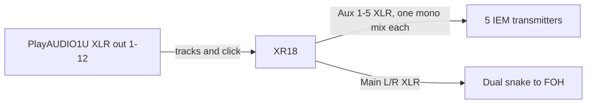

# IEM mixes

[Eugene Fight Club playback rig](../README.md)

The XR18 is assumed to be the on-stage mixer: PlayAUDIO1U outputs in, aux sends to IEMs, main L/R to the snake. The dual snake is assumed to carry XR18 mains and spare channels to FOH. Confirm channel count and whether it is send and return.

The XR18 has six aux sends on XLR (Behringer manual), an Ultranet port for P16 personal mixers, USB 18x18 audio and MIDI, and a REMOTE switch that selects Ethernet, Wi-Fi client or its own access point. Set REMOTE to Ethernet on the show switch. See [Network and IP plan](network-and-ip-plan.md).

Retailers list the XR18 as a 3U rackmount that ships with rack ears, so it does not need a rack kit to be racked. Its listed 333 mm width with ears is narrower than a 19 in panel, so check fit before buying 19 in third-party ears ($17.99 to $24.59). XR18: 3U, 7.1 lb (3.2 kg), 30 W. Rack it with its ears in a Gator GR-3S (3U, 14.25 in, $239.99) or leave it on a stand as a stage box.

The XR18 sample rate is not verified here. The PlayAUDIO1U supports 44.1, 48, 88.2 and 96 kHz; set both to the same rate after checking the XR18 manual.

## Five mixes

> [!WARNING]
> Five mono mixes use Aux 1 to 5 and leave Aux 6 spare. Stereo mixes use two auxes each, so only three fit.

Five mono IEM mixes fit the XR18's six aux sends. Five stereo mixes do not (stereo needs two aux sends each, so three at most). One mono mix per player.

1RU wireless is assumed to be IEM transmitters. Not confirmed; the IEM options below replace it.

Suggested PlayAUDIO1U map (not from a manual): output 1 is click to an XR18 channel, aux sends only, not main. Output 2 is guide / cues, aux only. The full map is in [Cable schedule](cable-schedule.md).

## Transmitter options

IEM transmitters ride in the stage case or on the XR18 lid. Five Shure P3T half-racks need 3U with RPW504 kits; five Xvive U4 transmitters need none.

| Tier | Pick | Price | Size and fit | Notes |
| --- | --- | --- | --- | --- |
| Budget | Xvive U4 (one transmitter per mix) | U4R4 bundle $479.99 to $599.99; single transmitter unknown | Tiny, no rack space | 2.4 GHz, mono, 6 simultaneous channels, 5 ms latency. The U4R4 sends one mix to four receivers, so you need five transmitters for five mixes. |
| Mid | Sennheiser XSW IEM Set (B band) | $469 Thomann, $549 Guitar Center, $658 Sweetwater | 200 x 128 x 42 mm, 0.7 kg each, rack kit included | 572 to 596 MHz. Five sets means five units, about 5U if racked. |
| Pro | Shure PSM300 P3T half-rack transmitter | $399 or $507 depending on seller | Two P3T fit 1U with the $28 RPW504 kit | Receivers sold separately. Twin packs list at $1,199. |
| Pro alt | Sennheiser ew IEM G4 | $1,249 | Half-rack, stereo or mono | Bands include A 516 to 558 MHz and G 566 to 608 MHz. |

Prices seen Nov 26, 2026. Unknown means no price was found.

- US legality: IEMs may not operate in 617 to 652 MHz or 663 to 698 MHz (FCC). Unlicensed use is allowed on TV channels 2 to 36, 614 to 616 MHz and 657 to 663 MHz. Avoid Sennheiser XSW band C (662 to 686 MHz).
- Five channels need coordinated frequencies. Use each maker's frequency tool and scan at the venue.
- Control tradeoff: tablets running the X AIR app over the wired switch let each player mix their own aux send but depend on a stable network. Wired Behringer P16-M personal mixers run off the XR18's single Ultranet and give each player their own mix of a shared 16-channel set, but they use wired earbuds and not the wireless IEMs.
- The PlayAUDIO1U's headphone output has two independent mixes and can serve a click-only backup for one player.

## Open items

- 1RU wireless: assumed to be IEM transmitters, not confirmed.
- Dual snake: confirm channel count and whether it is send and return.
- XR18 role: assumed, as above.
- XR18 sample rate: not verified against the PlayAUDIO1U rates.
- XR18 19 in third-party ears: check fit before buying ($17.99 to $24.59).
- Single Xvive U4 transmitter price: unknown.

## Sources

- [XR18 user manual](https://mediadl.musictribe.com/media/PLM/data/docs/X-AIR/M_BE_0605-AAA_X-AIR_EN.pdf) (Behringer)
- [XR18 specs (3U, rack ears)](https://www.thomannmusic.com/behringer_x_air_xr18.htm) (Thomann)
- [Xvive U4R4](https://www.guitarcenter.com/XVive/U4R4-In-Ear-Monitor-Wireless-System-Transmitter-One-and-Four-Receiver-1500000311293.gc) (Guitar Center)
- [Sennheiser XSW IEM Set B](https://www.thomannmusic.com/sennheiser_xsw_iem_set_b_band.htm) (Thomann)
- [Shure P3T](https://creationnetworks.net/products/shure-p3t-transmitter-for-psm300-systems) (Creation Networks)
- [FCC wireless microphones](https://www.fcc.gov/wireless/bureau-divisions/broadband-division/wireless-microphones) (FCC)
- [PlayAUDIO1U product page](https://www.iconnectivity.com/playaudio1u) (iConnectivity)
