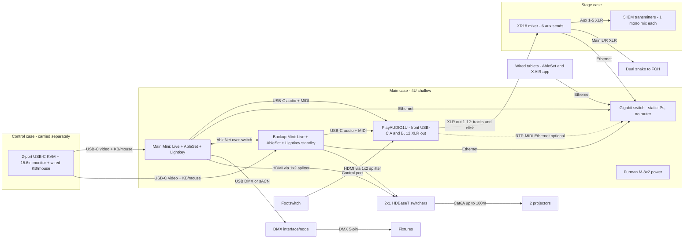
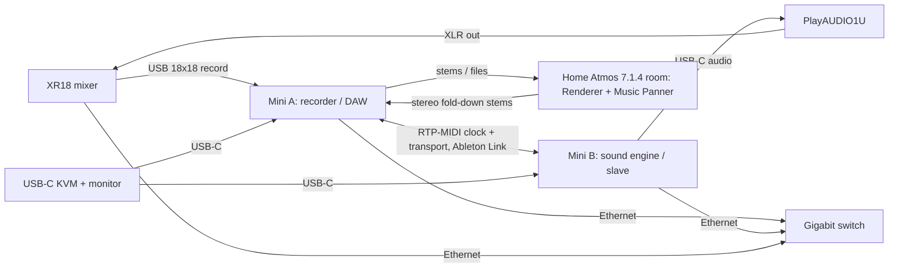
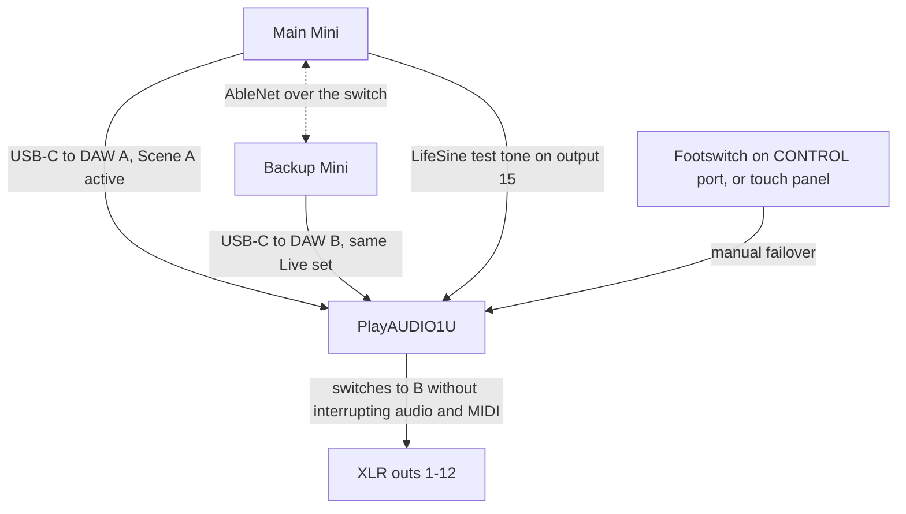

# Modes and checklists

[Eugene Fight Club playback rig](../README.md)

Two modes: perform (redundant playback) and record / studio. Save one XR18 scene and one Audio MIDI Setup configuration per mode, and keep two Live templates (record and perform).

Mac mini M2 (2023 chassis) is confirmed, not M4. Mount, case, and ports are in [Cases and rack layout](cases-and-rack-layout.md).

## Signal flow

### Perform (redundant playback)

### Record

## Failover

Run the same Ableton Live set on both Minis, plugged into the two front USB-C ports of the PlayAUDIO1U. Scene A should be the active scene. Route tracks to identical outputs on both computers, as iConnectivity's redundancy guide says.

On the Main Mini, add iConnectivity's free LifeSine plugin on a track and set its output to output 15. A blinking shield icon on the display means it is armed. Start playback on both, then pull the USB cable from DAW A. The PlayAUDIO1U should switch to B without interrupting audio and MIDI. Assign the failover function to a CONTROL port in Auracle X for a footswitch. Manual failover is also on the touch panel.

In perform mode, keep Mini-to-Mini RTP sessions off or unrouted so transport commands are not duplicated. Both Minis already get the same MIDI through the PlayAUDIO1U. AbleSet's MIDI input AbleNet toggle: leave off if all computers receive MIDI (as here), turn on only if one computer receives it.

These USB-C KVMs use a button or remote. Keep the monitor on the Backup Mini during the first song to confirm it tracks the Main.

## AbleSet, Live and failover

AbleSet Standard ($179) runs on two computers and includes AbleNet and redundant interface support. Pro ($269) adds the mixer, Canvas and OSC Tracks. The docs are at [ableset.com](https://ableset.com/).

| Feature | What the docs say |
| --- | --- |
| AbleNet | Decentralised: any computer can crash and AbleSet keeps working while one stays online. Open the same Ableton session and enable AbleNet on all computers. |
| Browser control | Open AbleSet from any computer's IP address; if that computer goes offline AbleSet redirects to the next available one. |
| Drift correction | Uses Phase Nudge; enable on the backup only. All audio clips must be warped. |
| Custom IPs | AbleNet finds peers via Bonjour; if not, enter each other's IP in Connect to Custom IPs. Static IPs simplify this. |
| Sync Playback Now | After a crash, re-syncs the playhead and restarts playback in a few seconds. |
| Redundant interfaces | Supports PlayAUDIO12, PlayAUDIO1U and PlayAUDIO2U, detected over USB. |
| Follow Current Audio Interface Scene | Per device: the browser follows whichever computer is active on the interface. |
| +FOLLOWSCENE flag | Unmutes a track only on the computer selected on the interface. |
| MIDI mapping | Maps Notes, PC and CC. The Go button covers play, next song and loop escape. |
| OSC | Listens on port 39051. OSC Tracks (Pro) send timed commands to other devices. |

1. **Same set, same samples, same sample rate.** AbleSet warns that loading a different set on each computer changes behaviour when jumping songs.
2. **Wire both Minis to the switch.** AbleNet tips say Ethernet avoids wireless interference.
3. **Enable AbleNet on both.** Use custom IPs if Bonjour does not discover the peer.
4. **Turn on Follow Current Audio Interface Scene on the tablet.** So the tablet always shows the computer sending audio to the PA.
5. **Soundcheck.** Run a failover test (pull DAW A), then Sync Playback Now.

Ableton's license policy covers two active computers owned by the registered user, which suits a main and a backup. Live 13 is due in early 2027 and Live 12 Suite owners can pre-order it at 20% off.

## Per-mode settings

| Setting | Record / Studio | Perform |
| --- | --- | --- |
| Minis | A = recorder/DAW, B = sound engine or slave | Main + Backup running the same set |
| XR18 USB | Connected to Mini A, 18 in / 18 out | Unplugged; tracks come from PlayAUDIO1U via XLR |
| PlayAUDIO1U | Monitoring out; failover not armed | Scene A active, LifeSine armed, footswitch assigned |
| AbleSet | Optional; AbleNet off | On, AbleNet on both, drift correction on backup only |
| Audio MIDI Setup | RTP sessions between Minis, MIDI clock and transport routed | Mini-to-Mini sessions off or unrouted |
| Ableton sync | Link, optionally Start Stop Sync, between Minis | Link off; AbleNet handles sync |
| XR18 scene | Save as REC-STUDIO: USB routing, studio monitors | Save as PERFORM: aux 1-5 to IEMs, main to snake |
| Lightkey / video | Off | On (Main), projectors connected |
| KVM | Control case or studio monitor | Control case, watch both Minis |

## Switchover checklists

### Perform

1. Unplug XR18 USB from Mini A.
2. Recall XR18 scene PERFORM.
3. Switch Audio MIDI Setup to the perform configuration; disable Mini-to-Mini sessions.
4. Confirm static IPs and the switch link lights.
5. Open the same Live set and AbleSet on both Minis; enable AbleNet.
6. Arm LifeSine on output 15; check the shield icon.
7. Pull USB A as a failover test, then Sync Playback Now.
8. Check Lightkey output, DMX, and projectors on both switcher inputs.
9. Verify five IEM mixes and click.

### Record

1. Connect XR18 USB to Mini A and select it as the audio device.
2. Recall XR18 scene REC-STUDIO.
3. Load the record Audio MIDI Setup configuration; connect the RTP sessions.
4. Enable Link (and Start Stop Sync if wanted) in Live on both Minis.
5. Turn off AbleNet and failover arming.
6. Check the PlayAUDIO1U monitoring route.
7. Back up the session before recording.

Video failover is separate from the PlayAUDIO1U. A crashed app on a live Mac still outputs a picture, so HDBaseT auto-switching may not trigger; plan a manual switch. See [Video (projectors)](video-projectors.md).

On a Main failure the lights hold their last look if the USB-DMX interface has a built-in microprocessor. Moving the Lightkey license is slow. See [Lighting (Lightkey)](lighting-lightkey.md).

## Sources

- [AbleNet redundant playback](https://ableset.com/docs/ablenet) (AbleSet)
- [Redundant audio interfaces](https://ableset.com/docs/audio-interfaces) (AbleSet)
- [Network setup](https://ableset.com/docs/network) (AbleSet)
- [MIDI mapping](https://ableset.com/docs/midi-mapping) (AbleSet)
- [OSC tracks](https://ableset.com/docs/osc-tracks) (AbleSet)
- [AbleSet editions and prices](https://ableset.com/) (AbleSet)
- [Redundant playback rig with PlayAUDIO1U](https://www.iconnectivity.com/blog/creating-a-redundant-playback-rig-with-playaudio1u) (iConnectivity)
- [PlayAUDIO1U product page](https://www.iconnectivity.com/playaudio1u) (iConnectivity)
- [License policy for Live](https://help.ableton.com/hc/en-us/articles/209772745-License-policy-for-Live) (Ableton)
- [Synchronizing with Link and MIDI](https://www.ableton.com/en/live-manual/12/synchronizing-with-link-tempo-follower-and-midi/) (Ableton)
- [Share MIDI over a network](https://support.apple.com/guide/audio-midi-setup/set-up-a-midi-network-session-ams1012/mac) (Apple)
