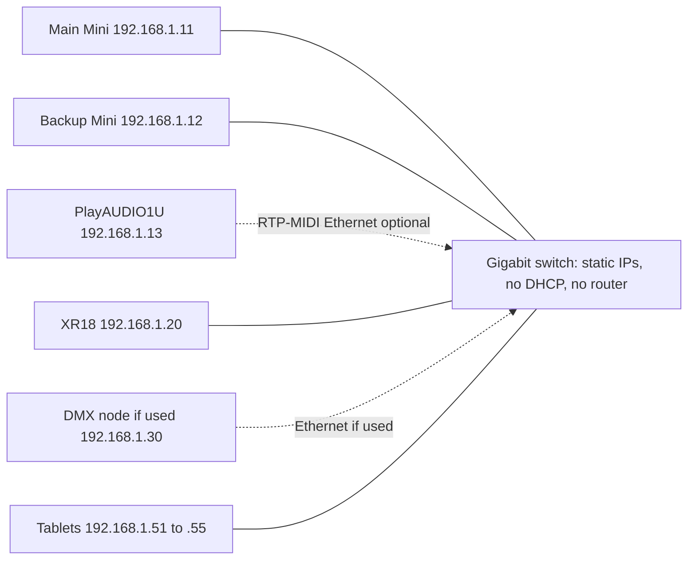

# Network and IP plan

[Eugene Fight Club playback rig](../README.md)

The switch has no DHCP server, so use static IPs. AbleSet's docs say to use matching first three octets and a 255.255.255.0 mask on a switch network. The XR18 defaults to DHCP client and self-assigns a 169.254.x.x address when no DHCP server exists, so set it static.

The show switch is a wired unmanaged gigabit switch with static IPs and no router. In the 6U case that switch is the TP-Link TL-SG1016D (16-port). It is listed as 13 in rackmountable; confirm 19 in ears or use a shelf. The 4U build uses a small unmanaged switch velcroed to the mount or case lid (model and price not verified).

Latency tips: wired only, no Wi-Fi, unmanaged switch, short Cat6. Set the XR18 REMOTE switch to Ethernet. The REMOTE switch selects Ethernet, Wi-Fi client or its own access point.

HDBaseT extenders to the projectors are not Ethernet. Keep them off the network switch. See [Video (projectors)](video-projectors.md).

## Addresses

| Device | IP | Note |
| --- | --- | --- |
| Main Mini | 192.168.1.11 | Mask 255.255.255.0, no gateway |
| Backup Mini | 192.168.1.12 | Mask 255.255.255.0 |
| PlayAUDIO1U | 192.168.1.13 | Static in Auracle X (automatic also works) |
| XR18 | 192.168.1.20 | Static; avoid 192.168.1.1, its DHCP-server address |
| DMX node (if used) | 192.168.1.30 | Art-Net needs the same subnet |
| Tablets | 192.168.1.51 to .55 | Wired Ethernet adapters (owned) |

AbleNet finds peers via Bonjour; if not, enter each other's IP in Connect to Custom IPs. Static IPs simplify this. Keep all static IPs on a laminated card.

Wired tablets use Ethernet adapters (owned) for the AbleSet web app and the X AIR app. Open AbleSet from any computer's IP address.

## Topology

RTP-MIDI session setup is in [RTP-MIDI setup](rtp-midi-setup.md). The PlayAUDIO1U Ethernet port is the rear RTP-MIDI port. Mini-to-Mini RTP sessions stay off or unrouted in perform mode.

DMX node (if used) is 192.168.1.30. Art-Net needs the same subnet. Lightkey says it recommends no particular network brand. The recommended path is Lightkey on the Main Mini with an Enttec USB interface; the cable to a DMX interface or sACN node is USB or Ethernet.

## Home dock

Dock the case at home with the front I/O panel and a single Ethernet uplink. Keep the rig's 192.168.1.x subnet separate from the home router to avoid clashes. See [Atmos integration](atmos-integration.md).

## Open items

- 4U-build switch: model and price not verified.
- TL-SG1016D: listed as 13 in rackmountable; confirm 19 in ears or use a shelf.
- DMX node address is only if a node is used.

## Sources

- [Network setup](https://ableset.com/docs/network) (AbleSet)
- [AbleNet redundant playback](https://ableset.com/docs/ablenet) (AbleSet)
- [TL-SG1016D](https://www.microcenter.com/product/715627/tp-link-tl-sg1016d-16-port-gigabit-desktop-rackmount-switch) (Micro Center)
- [XR18 user manual](https://mediadl.musictribe.com/media/PLM/data/docs/X-AIR/M_BE_0605-AAA_X-AIR_EN.pdf) (Behringer)
- [Lightkey tech specs](https://www.lightkeyapp.com/en/specs) (Lightkey)
- [RTP-MIDI with PlayAUDIO1U](https://www.iconnectivity.com/blog/2024/11/12/sending-midi-over-long-distances-via-ethernet) (iConnectivity)
