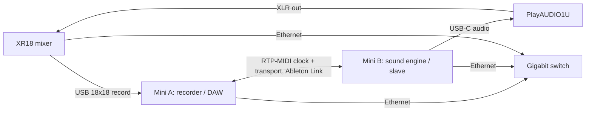

# RTP-MIDI setup

[Eugene Fight Club playback rig](../README.md)

Addresses and the switch are in [Network and IP plan](network-and-ip-plan.md). The PlayAUDIO1U RTP-MIDI port is Ethernet on the rear. PlayAUDIO1U address in this plan: 192.168.1.13, set static in Auracle X (automatic also works).

Keith's front USB-A host port is broken, so a controller can come in over the 5-pin DIN MIDI input, the Ethernet RTP-MIDI port, a footswitch on the Control ports, or AbleSet on a wired tablet.

## When the sessions are connected

Perform mode: both Minis already get the same MIDI through the PlayAUDIO1U, so keep Mini-to-Mini RTP sessions off or unrouted to avoid duplicate transport commands.

Record / studio: RTP sessions between the Minis, with MIDI clock and transport routed. The record-mode link is RTP-MIDI clock and transport, plus Ableton Link, between Mini A (recorder / DAW) and Mini B (sound engine / slave).

AbleSet's MIDI input AbleNet toggle: leave off if all computers receive MIDI (as here), turn on only if one computer receives it.

Lightkey Live Triggers use a local MIDI port on the same Mac, so they need no RTP.

Computer-hosted sessions need a manual reconnect after a restart; an initiator interface reconnects itself.

Latency tips: wired only, no Wi-Fi, unmanaged switch, short Cat6.

## Audio MIDI Setup

1. **Open Audio MIDI Setup.** Window, Show MIDI Studio, then Configure Network Driver.
2. **Add a session.** Click Add under My Sessions and choose RTP. Name it MAIN-RTP on the Main Mini and BACKUP-RTP on the Backup Mini.
3. **Set the network name and port.** Apple warns if the network name is a duplicate. Then turn on Enabled.
4. **Set the connection policy.** In Who may connect to me choose a permitted option. iConnectivity's guide uses Anyone for the interface to connect.
5. **Connect the peer.** Select the other Mini's session and click Connect. It appears under Connected Peers.
6. **Add live routings.** Choose which MIDI devices each session shares.
7. **Optional: PlayAUDIO1U as initiator.** In Auracle X, open the RTP / Network MIDI page, pick a port, set Initiator and type the exact, case-sensitive session name. It then reconnects automatically.

Save one Audio MIDI Setup configuration per mode (record and perform), and pre-load them. Perform checklist: switch to the perform configuration and disable Mini-to-Mini sessions. Record checklist: load the record configuration and connect the RTP sessions. See [Modes and checklists](modes-and-checklists.md).

## Record-mode clock path

## Sources

- [Share MIDI over a network](https://support.apple.com/guide/audio-midi-setup/set-up-a-midi-network-session-ams1012/mac) (Apple)
- [RTP-MIDI with PlayAUDIO1U](https://www.iconnectivity.com/blog/2024/11/12/sending-midi-over-long-distances-via-ethernet) (iConnectivity)
- [PlayAUDIO1U product page](https://www.iconnectivity.com/playaudio1u) (iConnectivity)
- [PlayAUDIO1U user guide](https://www.bhphotovideo.com/lit_files/1048735.pdf) (B&H)
- [Network setup](https://ableset.com/docs/network) (AbleSet)
- [Synchronizing with Link and MIDI](https://www.ableton.com/en/live-manual/12/synchronizing-with-link-tempo-follower-and-midi/) (Ableton)
- [MIDI mapping](https://ableset.com/docs/midi-mapping) (AbleSet)
