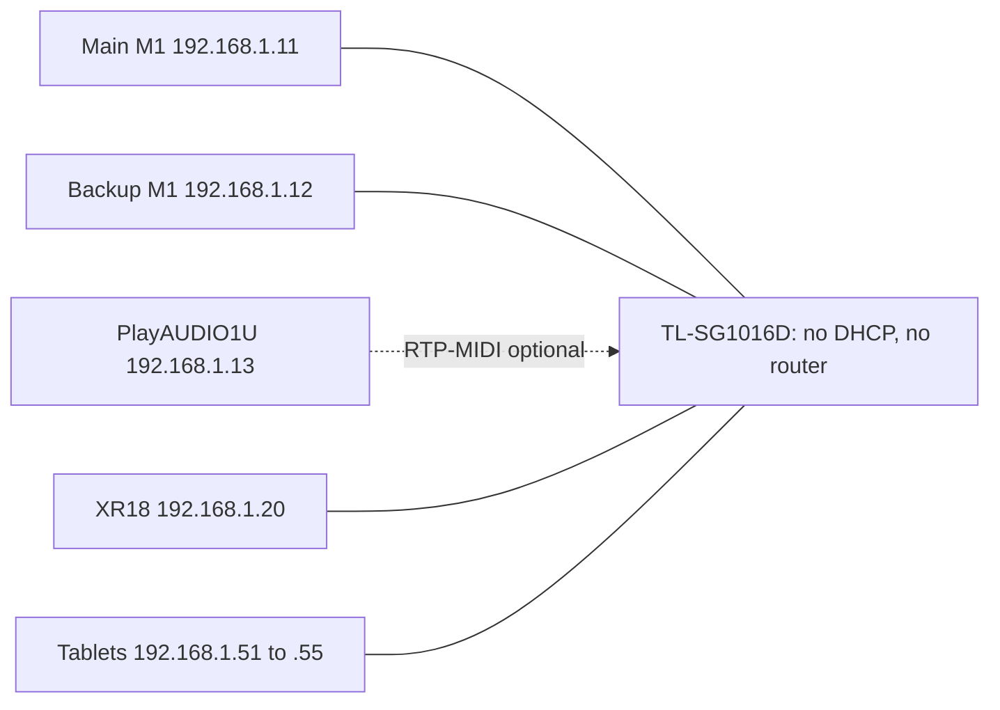

# RTP-MIDI setup

[Eugene Fight Club playback rig](../README.md)

A numbered setup for Apple Network MIDI (RTP sessions) on the two confirmed Mac mini (M1, Late 2020) computers. Addresses come from the [network plan](network-and-ip-plan.md). Perform versus record behavior comes from [modes and checklists](modes-and-checklists.md).

Menu names below are copied from the current Apple, Ableton, AbleSet, iConnectivity, and Lightkey pages that were opened for this guide. Where a click is not in those pages, it is marked **Unverified**.

## 1. Prerequisites

1. Both Minis are Mac mini (M1, 2020), 16GB / 512GB. Each has Gigabit Ethernet. 10Gb Ethernet is a configure-to-order option and is not these units. [Apple tech specs](https://support.apple.com/en-us/111894).
2. A wired unmanaged gigabit switch. This plan uses the TP-Link TL-SG1016D. It has no DHCP server and no router. [Network plan](network-and-ip-plan.md).
3. Cat5e or Cat6 from each Mini’s Ethernet port to that switch. AbleSet’s stage note is to prefer wired Ethernet because wireless gear causes interference. [Connecting to AbleSet](https://ableset.app/docs/network).
4. Audio MIDI Setup, which is on the Mac. Apple’s page is [Share MIDI information over a network](https://support.apple.com/guide/audio-midi-setup/set-up-a-midi-network-session-ams1012/mac).
5. Ableton Live on both Minis. MIDI port switches are in Live’s Link, Tempo & MIDI Settings. [Routing and I/O](https://www.ableton.com/en/live-manual/12/routing-and-i-o/).
6. AbleSet on both Minis for perform mode. [AbleNet](https://ableset.app/docs/ablenet).
7. Optional: PlayAUDIO1U on the same switch if its rear Ethernet RTP-MIDI port is used. Configuration is in Auracle X, not in an app named iConfig. [Auracle X](https://www.iconnectivity.com/auracle-x-series). [iConnectivity’s RTP article](https://www.iconnectivity.com/blog/2024/11/12/sending-midi-over-long-distances-via-ethernet).

## 2. Static IPs on each M1

Apple’s path for a manual IPv4 address: Apple menu > System Settings > Network, click the Ethernet service, click Details, click TCP/IP, set Configure IPv4 to Manually, enter the address, subnet mask, and router, then click OK. [Use DHCP or a manual IP address](https://support.apple.com/guide/mac-help/use-dhcp-or-a-manual-ip-address-on-mac-mchlp2718/mac). If the Mac is using a USB Ethernet adapter, Apple says the service name may be the adapter name rather than “Ethernet”. [Ethernet connection](https://support.apple.com/en-lb/guide/mac-help/mh119392/mac).

Do this on each Mini. The plan’s mask is `255.255.255.0`. The switch has no router.

| Mini | IP | Router field |
| --- | --- | --- |
| Main (recorder / Mini A in record mode) | `192.168.1.11` | Leave blank. The plan says no gateway. |
| Backup (sound engine / Mini B in record mode) | `192.168.1.12` | The plan prints only the mask for this Mini. The switch still has no router, so leave Router blank here too. **Unverified** as an extra Apple step; it follows “no router” in the network plan. |

1. Confirm the service is up and the switch link light for that port is on.
2. Do not use `192.168.1.1`. That is the XR18’s DHCP-server address when it is an access point. This show uses static `192.168.1.20` and REMOTE set to Ethernet.
3. **Unverified:** macOS before Ventura used System Preferences > Network > Advanced instead of System Settings > Details. These Minis can run older macOS. Use the labels on the machine in front of you if they differ.

## 3. Wired topology

HDBaseT runs to the projectors are not Ethernet. Keep them off this switch. [Video](video-projectors.md).

## 4. Create the sessions

Apple’s current steps, applied to this pair. [Share MIDI information over a network](https://support.apple.com/guide/audio-midi-setup/set-up-a-midi-network-session-ams1012/mac).

On **each** Mini:

1. Open Audio MIDI Setup.
2. Choose Window > Show MIDI Studio.
3. In the MIDI Studio window, click Configure Network Driver in the toolbar.
4. Under My Sessions, click Add.
5. Choose session type **RTP**. Apple also offers Network MIDI 2.0. This rig’s PlayAUDIO1U notes are RTP, so use RTP unless you are deliberately testing MIDI 2.0. **Unverified:** whether the PlayAUDIO1U speaks Network MIDI 2.0. iConnectivity’s article is about RTP.
6. Under Session Details, set Local Name to `MAIN-RTP` on the Main Mini and `BACKUP-RTP` on the Backup Mini.
7. Set Port and Network Name. If a warning icon appears next to Network Name, Apple says the name is a duplicate. Pick a distinct name.
8. Turn on Enabled so the session is published.
9. Lightkey’s help still says MIDI Studio > Open MIDI Network Setup, then a Bonjour name and an Enabled checkbox. [How can I receive MIDI from another computer?](https://www.lightkeyapp.com/en/help). If your window says Bonjour Name instead of Network Name, that is the older label for the same field. Prefer the labels on the Mac you are using.

## 5. Participants, directory, and who may connect

1. For a computer **not** on the local network, Apple says: under Sessions and Directories, click Add, enter name, host, and port, then OK. These two Minis are on the same switch, so that Add step is for off-LAN peers, not for each other.
2. Lightkey’s help, for a peer that is on the LAN: on the sending Mac, select the other computer’s session in the Directory section and click Connect. [Lightkey help](https://www.lightkeyapp.com/en/help).
3. Apple’s current page says click Connect to start a session. Computers in the session appear under Connected Peers.
4. Who may connect to me: Apple’s current page says the Connection policy menu includes “No one” (with a lock) and other permission levels. It does not list every level. iConnectivity’s article and support note, and Lightkey’s help, all say choose **Anyone** so the other device can join. [iConnectivity RTP article](https://www.iconnectivity.com/blog/2024/11/12/sending-midi-over-long-distances-via-ethernet). [Auto-connect RTP ports](https://iconnectivitysupport.zendesk.com/hc/en-us/articles/27313966621339-Auto-connect-your-RTP-ports-to-a-computer-Mac-Win). Use Anyone on this closed switch. Do not leave the policy on No one.
5. Live routings: Apple says click Live routings under Session Details and choose which MIDI devices the session shares.

## 6. Latency

Apple’s current network-MIDI page does not document a latency slider or a number to type. **Unverified:** any specific millisecond setting in Audio MIDI Setup.

What is documented:

- This plan’s latency note: wired only, no Wi-Fi, unmanaged switch, short Cat6.
- Ableton’s Sync Delay is per MIDI port in the Tempo & MIDI Settings MIDI Ports list. It delays Live’s time base against the sync signal. [Synchronizing via MIDI](https://www.ableton.com/en/live-manual/12/synchronizing-with-link-tempo-follower-and-midi/).

Do not invent a Sync Delay value. Adjust it only if you can hear the two machines apart, using Ableton’s own listening method on that page.

## 7. After reboot or login

Apple’s current page does not say the Connect button survives a restart. iConnectivity’s support article does: a session you create on the computer must be connected again after every restart. An interface set as Initiator reconnects itself. [Auto-connect RTP ports](https://iconnectivitysupport.zendesk.com/hc/en-us/articles/27313966621339-Auto-connect-your-RTP-ports-to-a-computer-Mac-Win).

1. After each Mini boots, open Audio MIDI Setup and confirm the session is still Enabled.
2. In record mode, click Connect again so the other Mini is under Connected Peers.
3. **Unverified:** a Login Item or “reopen windows at login” that would press Connect for you. This guide does not add one.

## 8. Ableton Live MIDI ports

Live 12 documents this in Link, Tempo & MIDI Settings, MIDI section. [Track, Sync, and the port list](https://www.ableton.com/en/live-manual/12/routing-and-i-o/).

| Switch | What Live’s manual says |
| --- | --- |
| Track in | Receive notes and CC. Record notes and CC into clips. |
| Track out | Send notes and CC to a device or another app. |
| Sync in | Follow MIDI Clock or MIDI Timecode from that port. |
| Sync out | Send MIDI Clock. Extra options sit behind the triangle next to the port name, including MIDI Clock Sync Delay. |
| Remote in | Remote-control Live. The Remote column must be On. [MIDI and Key Remote](https://www.ableton.com/en/live-manual/12/midi-and-key-remote-control/). |

**Unverified:** the menu title that opens Settings on your build (Live > Settings versus Preferences). The manual calls the page Link, Tempo & MIDI Settings.

Record mode, both Minis, on the network session ports:

1. Track in and Track out on, so notes can cross.
2. Sync out on the machine that is the clock host. Sync in on the machine that should follow. Do not enable Sync in and Sync out on the same port in both directions without a reason. Ableton’s help page warns that Sync in and Sync out together on one device can loop. [Live’s MIDI Settings](https://help.ableton.com/hc/en-us/articles/209774205-Live-s-MIDI-Settings).
3. The plan also allows Ableton Link, and optionally Start Stop Sync, between the Minis in record mode. Link is separate from RTP. [Synchronizing via Link](https://www.ableton.com/en/live-manual/12/synchronizing-with-link-tempo-follower-and-midi/). Start Stop Sync only works for peers that also have it on.

Perform mode:

1. Link off. AbleNet handles sync. [Modes](modes-and-checklists.md).
2. Mini-to-Mini RTP sessions off or with Live routings cleared, so transport is not doubled.
3. iConnectivity’s article, for MIDI that should go out the interface: in Live, enable Track on the RTP output port (their example is RTP5) and set the track’s MIDI To to that port. Do that only if you are actually sending MIDI through the PlayAUDIO1U’s RTP port. [iConnectivity RTP article](https://www.iconnectivity.com/blog/2024/11/12/sending-midi-over-long-distances-via-ethernet).

## 9. AbleNet versus RTP, and the tablet

They are different.

- RTP-MIDI moves MIDI bytes. In **record** mode it carries clock and transport between the Minis. In **perform** mode leave Mini-to-Mini RTP off or unrouted, because both Minis already receive MIDI from the PlayAUDIO1U.
- AbleNet moves AbleSet’s setlist control. Enable it in AbleSet’s settings on both computers, with the same Live set open. [AbleNet](https://ableset.app/docs/ablenet).
- If Bonjour misses the peer, Settings > AbleNet > Connect to Custom IPs. Main enters `192.168.1.12`. Backup enters `192.168.1.11`.
- Drift correction on the backup only. Clips must be warped.
- Each MIDI input has an AbleNet toggle. Leave it off when every computer already receives the MIDI, which is this perform rig. Turn it on only if one computer receives the controller. [MIDI mapping](https://ableset.app/docs/midi-mapping).
- Tablet: wired, `192.168.1.51` to `.55`, browser to the address shown in AbleSet’s menu-bar window. The plan does not name the web port. AbleSet redirects to the other computer if the one you opened goes offline. [AbleNet](https://ableset.app/docs/ablenet).

## 10. PlayAUDIO1U as an RTP device

1. Install Auracle X from [the Auracle X page](https://www.iconnectivity.com/auracle-x-series). The user guide in this repo is [auracle-x-user-guide-2.6.pdf](manuals/auracle-x-user-guide-2.6.pdf). The official file is [Auracle X User Guide 2.6](https://www.iconnectivity.com/s/auracle-x-user-guide-260-20261013.pdf).
2. iConnectivity’s article: open the RTP / Network MIDI tab. Ports are listed there. Their example uses RTP5, type set to Initiator, and the other session’s Bonjour or Network Name typed exactly, then Save.
3. The rig plan uses the same idea: Initiator, exact case-sensitive session name, so the interface reconnects after a restart.
4. Their default routing enables that RTP port on Scene A for USB DAW jack A, and on Scene B for jack B, so a scene change does not send the same MIDI from both computers at once.
5. **Unverified in the PDF text of the guide:** this page did not re-quote the guide’s own RTP chapter. The steps above are from the manufacturer’s article, not from a line number in the PDF.

## 11. Lightkey

Live Triggers need Ableton Live on the same Mac while cues are placed on the timeline. Lightkey’s spec says Live 9 or newer on the same computer. [Lightkey specs](https://www.lightkeyapp.com/en/specs).

Lightkey’s help says external MIDI from another computer uses the network session, and that Lightkey’s Settings (or Preferences) > External Control should show that session under Input. [Lightkey help](https://www.lightkeyapp.com/en/help).

For this perform rig, Live Triggers stay on the Main Mini and do not need Mini-to-Mini RTP. Channel 16 is not a general remote-control channel: Lightkey’s Stream Deck note says use channels 1–15 and do not use channel 16. Older Lightkey sent Live Trigger feedback on channel 16 and then disabled that feedback. [Lightkey help](https://www.lightkeyapp.com/en/help).

## 12. Record mode

Mini A is the Main Mini (`192.168.1.11`), the recorder. Mini B is the Backup (`192.168.1.12`), the sound engine. [Modes](modes-and-checklists.md).

1. Connect XR18 USB to Mini A and select it as the audio device. 18 in / 18 out.
2. Recall XR18 scene REC-STUDIO.
3. Load the record Audio MIDI Setup configuration. Connect `MAIN-RTP` and `BACKUP-RTP` so each Mini is in the other’s Connected Peers.
4. In Live, enable Link on both. Turn on Start Stop Sync only if you want it on both.
5. Route MIDI clock and transport on the RTP ports as in section 8. Controllers you want printed into the recording go to Mini A (USB from the XR18, or a Track-enabled RTP input).
6. Turn AbleNet off. Do not arm LifeSine.
7. Back up the session before recording.

## 13. Redundant playback

1. Unplug XR18 USB from Mini A.
2. Recall XR18 scene PERFORM.
3. Switch to the perform Audio MIDI Setup configuration. Disable or unroute Mini-to-Mini sessions.
4. Confirm the static IPs and switch link lights.
5. Open the same Live set and AbleSet on both Minis. Enable AbleNet. Drift correction on the backup only.
6. Arm LifeSine on output 15. The shield icon should blink. [Cases](cases-and-rack-layout.md).
7. Link off.
8. Pull the USB cable from PlayAUDIO1U DAW A. Audio and MIDI should continue on B. Then Sync Playback Now.
9. Select HDMI switch input 2 and confirm both projectors follow the Backup, then return to input 1. [Video](video-projectors.md).

## 14. Test checklist

- [ ] Each Mini answers on its plan IP.
- [ ] Switch link lights are on. Wi-Fi is off.
- [ ] Record mode: the other session is under Connected Peers on both Minis.
- [ ] A note into a Track-enabled input moves the meter on a MIDI track’s Input Channel chooser. Live shows meters beside those entries. [Routing and I/O](https://www.ableton.com/en/live-manual/12/routing-and-i-o/).
- [ ] With Sync in enabled, the upper LED by the EXT button flashes when Live receives usable sync. The lower LED flashes when Live is sending sync. [Synchronizing via MIDI](https://www.ableton.com/en/live-manual/12/synchronizing-with-link-tempo-follower-and-midi/).
- [ ] Perform mode: Mini-to-Mini sessions are not connected, or Live routings are empty.
- [ ] AbleNet shows both computers. Tablet opens the menu-bar address.
- [ ] Failover pull of USB A does not stop audio. Sync Playback Now recovers a drifted playhead.

**Unverified:** Apple’s user-guide table of contents lists “Test your MIDI connection,” but the steps were not copied into this page. Use Live’s meters rather than an unquoted Audio MIDI Setup test button.

## 15. Troubleshooting

| Symptom | What to check | Source |
| --- | --- | --- |
| No session in the Directory | Ethernet link, IPs on `192.168.1.x` with mask `255.255.255.0`, Enabled on, Network Name not duplicated. | Apple network-MIDI page; [IP plan](network-and-ip-plan.md) |
| Policy blocks the peer | Connection policy is not “No one”. Use Anyone, as iConnectivity and Lightkey document. | Apple page names “No one”; Anyone is from iConnectivity and Lightkey |
| Connect is gone after reboot | Connect again. Computer sessions do not redo this by themselves. Use PlayAUDIO1U Initiator if that hop should return alone. | [iConnectivity support](https://iconnectivitysupport.zendesk.com/hc/en-us/articles/27313966621339-Auto-connect-your-RTP-ports-to-a-computer-Mac-Win) |
| Firewall | Apple menu > System Settings > Network > Firewall. “Block all incoming connections” stops nonessential inbound services. If a prompt asks to allow Audio MIDI Setup, allow it. | [Change Firewall settings](https://support.apple.com/guide/mac-help/change-firewall-settings-on-mac-mh11783/mac) |
| Wi-Fi | Turn it off for the show. The plan and AbleSet both prefer a wired stage network. **Unverified:** the exact Wi-Fi toggle label on every macOS build. | [AbleSet network](https://ableset.app/docs/network) |
| IP clash | Two devices on one address, or the XR18 left on `192.168.1.1` while the show plan uses `.20`. | [IP plan](network-and-ip-plan.md) |
| Double transports in perform | Mini-to-Mini RTP still routed, or the AbleNet MIDI toggle is on while both Minis already receive MIDI. | [Modes](modes-and-checklists.md); [MIDI mapping](https://ableset.app/docs/midi-mapping) |
| AbleNet peers missing | Connect to Custom IPs with `.11` and `.12`. Same set on both. Ethernet, not Wi-Fi. | [AbleNet](https://ableset.app/docs/ablenet) |
| After a macOS update | **Unverified:** which update changes Audio MIDI Setup labels. Re-open Configure Network Driver and confirm Enabled, the policy, and Connect. |

## Sources

- [Mac mini (M1, 2020) tech specs](https://support.apple.com/en-us/111894) (Apple)
- [Share MIDI information over a network](https://support.apple.com/guide/audio-midi-setup/set-up-a-midi-network-session-ams1012/mac) (Apple)
- [Use DHCP or a manual IP address](https://support.apple.com/guide/mac-help/use-dhcp-or-a-manual-ip-address-on-mac-mchlp2718/mac) (Apple)
- [Change Firewall settings](https://support.apple.com/guide/mac-help/change-firewall-settings-on-mac-mh11783/mac) (Apple)
- [Routing and I/O](https://www.ableton.com/en/live-manual/12/routing-and-i-o/) (Ableton)
- [Synchronizing with Link, Tempo Follower, and MIDI](https://www.ableton.com/en/live-manual/12/synchronizing-with-link-tempo-follower-and-midi/) (Ableton)
- [MIDI and Key Remote](https://www.ableton.com/en/live-manual/12/midi-and-key-remote-control/) (Ableton)
- [Live’s MIDI Settings](https://help.ableton.com/hc/en-us/articles/209774205-Live-s-MIDI-Settings) (Ableton)
- [AbleNet](https://ableset.app/docs/ablenet) (AbleSet)
- [MIDI mapping](https://ableset.app/docs/midi-mapping) (AbleSet)
- [Connecting from other devices](https://ableset.app/docs/network) (AbleSet)
- [Sending MIDI over Ethernet](https://www.iconnectivity.com/blog/2024/11/12/sending-midi-over-long-distances-via-ethernet) (iConnectivity)
- [Auto-connect RTP ports](https://iconnectivitysupport.zendesk.com/hc/en-us/articles/27313966621339-Auto-connect-your-RTP-ports-to-a-computer-Mac-Win) (iConnectivity)
- [Lightkey help](https://www.lightkeyapp.com/en/help) (Lightkey)
- [Lightkey specs](https://www.lightkeyapp.com/en/specs) (Lightkey)
