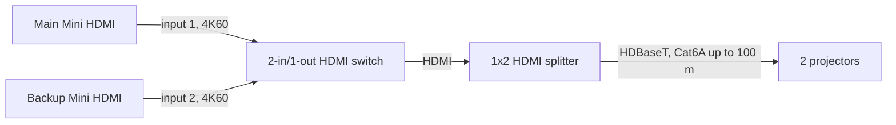

# Video (projectors)

[Eugene Fight Club playback rig](../README.md)

Ableton's video window hides when Live loses focus, so plan video around that limit.

Two projectors. M1 confirmed: two identical Mac mini (M1, Late 2020) units. The M1 has one HDMI 2.0 port and supports two displays at once (6K60 over Thunderbolt and 4K60 over HDMI). Never put projector outputs through the KVM.

- Live plays QuickTime .mov video, only in Arrangement View. The Video Window can go full screen on a second monitor by double-click.
- AbleSet's developer says Live hides the video window when its main window loses focus, and suggests VideoSync (Lite €79) as a separate window. Save the Live set with the native video window closed so it does not reopen.
- AbleSet has no built-in video playback. Documented routes: OSC Tracks (Pro) to a video player such as QLab (port 53000, /cue/{n}/start), or a MIDI track into QLab, or looping 'video loop' songs with +LOOPFULL.
- Mac mini (M1, 2020) supports up to two external displays: one up to 6K at 60Hz over Thunderbolt and one up to 4K at 60Hz over HDMI. Apple's 2020 specifications call that port HDMI 2.0.
- One Thunderbolt / USB 4 port is the USB-C KVM (display 1). The other is the PlayAUDIO1U, so it is not a second video output. HDMI 2.0 is display 2, one picture up to 4K60.
- Both Minis' HDMI outputs go into a 2-in/1-out HDMI switch: Main on input 1, Backup on input 2. The switch output goes into a 1x2 HDMI splitter, and each leg can then use an HDBaseT extender for the long run. Either Mini can feed both projectors. A 2x2 HDMI matrix is the alternative when each projector must be chosen separately. No model or price is specified for the switch, the splitter, or the matrix.
- Live's one video window feeds one display, so the splitter is how that one picture reaches both projectors. VideoSync or QLab would be for separate pictures, and this Mac still has only two display outputs once the KVM and PlayAUDIO1U are plugged in.
- Never put projector outputs through the KVM; use separate outputs.
- Long runs: HDBaseT extends 4K60 to 100 m over Cat6A. Key Digital lists 1080p to 150 m. Extenders are not Ethernet; keep them off the network switch.
- Failover: select the Backup on the 2-in/1-out HDMI switch (input 2). Kramer EXT3-21-XR-TR is a 2x1 4K60 HDBaseT switcher with last-connected or priority auto-switching (price unknown). Key Digital KD-PS22UTX is $1,049. Those are HDBaseT extenders/switchers from the earlier plan, not a priced pick for the new HDMI switch. A crashed app on a live Mac still outputs a picture, so auto-switching may not trigger; plan a manual switch.

In perform mode, Lightkey and video are on (Main), with projectors connected. In record / studio they are off. Check both inputs of the 2-in/1-out HDMI switch, then confirm the 1x2 splitter feeds both projectors.

Spare PlayAUDIO1U outputs 11-12 are suggested for video audio or an SMPTE-style tone if needed. That map is a starting suggestion, not from a manual. See [Cable schedule](cable-schedule.md).

OSC Tracks are an AbleSet Pro feature ($269). AbleSet listens on port 39051. OSC Tracks (Pro) send timed commands to other devices. See [Modes and checklists](modes-and-checklists.md).

Never put projector outputs through the KVM; use separate outputs.

Prices seen Nov 26, 2026. Kramer EXT3-21-XR-TR or Key Digital KD-PS22UTX: Unknown / $1,049. VideoSync (Lite €79).

## Open items

- M1 confirmed. The two-display limit above is Apple's M1 spec.
- 1x2 HDMI splitter price: unknown.
- Kramer EXT3-21-XR-TR price: unknown. Key Digital KD-PS22UTX is $1,049.
- A crashed app on a live Mac still outputs a picture, so auto-switching may not trigger; plan a manual switch.

## Sources

- [Working with video](https://www.ableton.com/en/live-manual/12/working-with-video/) (Ableton)
- [Live video window hides when unfocused](https://forum.ableset.app/t/ableste2-with-live-11-sending-video-on-external-screen/569) (AbleSet forum)
- [OSC tracks](https://ableset.com/docs/osc-tracks) (AbleSet)
- [Mac mini (M1, 2020) tech specs](https://support.apple.com/en-us/111894) (Apple)
- [Mac mini technical specifications, January 2021 (HDMI 2.0)](https://web.archive.org/web/20210126073214/https://www.apple.com/mac-mini/specs/) (Apple)
- [Kramer EXT3-21-XR-TR](https://www1.kramerav.com/us/product/ext3-21-xr-tr) (Kramer)
- [AbleSet editions and prices](https://ableset.com/) (AbleSet)
