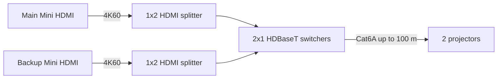

# Video (projectors)

[Eugene Fight Club playback rig](../README.md)

Ableton's video window hides when Live loses focus, so plan video around that limit.

Two projectors. Keith confirmed Mac mini M2 (2023), not M4. The M2 chip has one HDMI port and supports two displays at once. Never put projector outputs through the KVM.

- Live plays QuickTime .mov video, only in Arrangement View. The Video Window can go full screen on a second monitor by double-click.
- AbleSet's developer says Live hides the video window when its main window loses focus, and suggests VideoSync (Lite €79) as a separate window. Save the Live set with the native video window closed so it does not reopen.
- AbleSet has no built-in video playback. Documented routes: OSC Tracks (Pro) to a video player such as QLab (port 53000, /cue/{n}/start), or a MIDI track into QLab, or looping 'video loop' songs with +LOOPFULL.
- Mac mini (2023) with the M2 chip supports up to two external displays. Apple's options are one display up to 6K60 over Thunderbolt plus a second up to 5K60 over Thunderbolt, or the second up to 4K60 over HDMI. A hub or daisy-chain can put two displays on one Thunderbolt port, and does not raise that maximum. The M2 Pro chip can drive three displays; that chip is not this rig.
- One Thunderbolt port is the USB-C KVM (display 1). The other Thunderbolt port is the PlayAUDIO1U, so it is not a second video output. HDMI is display 2, one picture up to 4K60.
- Live's one video window feeds one display. A 1x2 HDMI splitter on that HDMI feeds both projectors. VideoSync or QLab would be for separate pictures, and this Mac still has only two display outputs once the KVM and PlayAUDIO1U are plugged in. Splitter price: unknown.
- Never put projector outputs through the KVM; use separate outputs.
- Long runs: HDBaseT extends 4K60 to 100 m over Cat6A. Key Digital lists 1080p to 150 m. Extenders are not Ethernet; keep them off the network switch.
- Failover: feed each projector from a 2x1 switcher with both Minis. Kramer EXT3-21-XR-TR is a 2x1 4K60 HDBaseT switcher with last-connected or priority auto-switching (price unknown). Key Digital KD-PS22UTX is $1,049. A crashed app on a live Mac still outputs a picture, so auto-switching may not trigger; plan a manual switch.

In perform mode, Lightkey and video are on (Main), with projectors connected. In record / studio they are off. The perform checklist says to check projectors on both switcher inputs. Each switcher still has an input from each Mini, after that Mini's 1x2 splitter.

Spare PlayAUDIO1U outputs 11-12 are suggested for video audio or an SMPTE-style tone if needed. That map is a starting suggestion, not from a manual. See [Cable schedule](cable-schedule.md).

OSC Tracks are an AbleSet Pro feature ($269). AbleSet listens on port 39051. OSC Tracks (Pro) send timed commands to other devices. See [Modes and checklists](modes-and-checklists.md).

Never put projector outputs through the KVM; use separate outputs.

Prices seen Nov 26, 2026. Kramer EXT3-21-XR-TR or Key Digital KD-PS22UTX: Unknown / $1,049. VideoSync (Lite €79).

## Open items

- Mac mini M2 (2023) is confirmed. The two-display limit above is Apple's M2 spec.
- 1x2 HDMI splitter price: unknown.
- Kramer EXT3-21-XR-TR price: unknown. Key Digital KD-PS22UTX is $1,049.
- A crashed app on a live Mac still outputs a picture, so auto-switching may not trigger; plan a manual switch.

## Sources

- [Working with video](https://www.ableton.com/en/live-manual/12/working-with-video/) (Ableton)
- [Live video window hides when unfocused](https://forum.ableset.app/t/ableste2-with-live-11-sending-video-on-external-screen/569) (AbleSet forum)
- [OSC tracks](https://ableset.com/docs/osc-tracks) (AbleSet)
- [Mac mini (2023) tech specs](https://support.apple.com/en-us/111837) (Apple)
- [How many displays on Mac mini (2023) with M2](https://support.apple.com/en-us/148273) (Apple)
- [Kramer EXT3-21-XR-TR](https://www1.kramerav.com/us/product/ext3-21-xr-tr) (Kramer)
- [AbleSet editions and prices](https://ableset.com/) (AbleSet)
