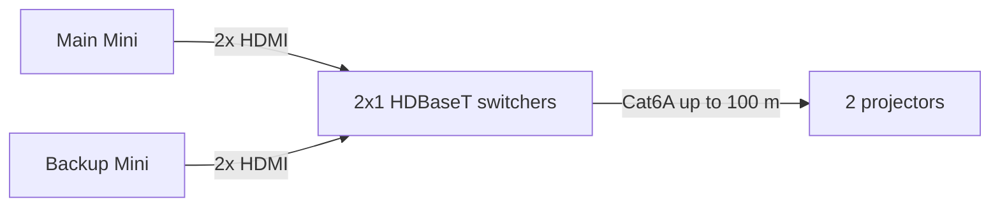

# Video (projectors)

[Eugene Fight Club playback rig](../README.md)

Ableton's video window hides when Live loses focus, so plan video around that limit.

Two projectors. Each Mini's two HDMI outputs go to 2x1 HDBaseT switchers, then Cat6A up to 100 m to the projectors. Never through the KVM. The Mac mini model (M4) is assumed and not confirmed. Confirm which physical ports carry video before cabling.

- Live plays QuickTime .mov video, only in Arrangement View. The Video Window can go full screen on a second monitor by double-click.
- AbleSet's developer says Live hides the video window when its main window loses focus, and suggests VideoSync (Lite €79) as a separate window. Save the Live set with the native video window closed so it does not reopen.
- AbleSet has no built-in video playback. Documented routes: OSC Tracks (Pro) to a video player such as QLab (port 53000, /cue/{n}/start), or a MIDI track into QLab, or looping 'video loop' songs with +LOOPFULL.
- Mac mini M4: up to three external displays; HDMI drives one display. With the KVM monitor on USB-C, that leaves two projector outputs.
- Live's one video window feeds one display, so mirror it (macOS mirror or a 1x2 HDMI splitter) for two projectors unless you use VideoSync or QLab for separate outputs.
- Never put projector outputs through the KVM; use separate outputs.
- Long runs: HDBaseT extends 4K60 to 100 m over Cat6A. Key Digital lists 1080p to 150 m. Extenders are not Ethernet; keep them off the network switch.
- Failover: feed each projector from a 2x1 switcher with both Minis. Kramer EXT3-21-XR-TR is a 2x1 4K60 HDBaseT switcher with last-connected or priority auto-switching (price unknown). Key Digital KD-PS22UTX is $1,049. A crashed app on a live Mac still outputs a picture, so auto-switching may not trigger; plan a manual switch.

Each M4 Mini needs one USB-C for the KVM, one for the PlayAUDIO1U, and its video for two projectors. Apple lists three external displays on M4: two over Thunderbolt or HDMI and one 4K60 over HDMI.

In perform mode, Lightkey and video are on (Main), with projectors connected. In record / studio they are off. The perform checklist says to check projectors on both switcher inputs.

Spare PlayAUDIO1U outputs 11-12 are suggested for video audio or an SMPTE-style tone if needed. That map is a starting suggestion, not from a manual. See [Cable schedule](cable-schedule.md).

OSC Tracks are an AbleSet Pro feature ($269). AbleSet listens on port 39051. OSC Tracks (Pro) send timed commands to other devices. See [Modes and checklists](modes-and-checklists.md).

Never put projector outputs through the KVM; use separate outputs.

Prices seen Nov 26, 2026. Kramer EXT3-21-XR-TR or Key Digital KD-PS22UTX: Unknown / $1,049. VideoSync (Lite €79).

## Open items

- Mac mini model: unknown. The plan assumes M4 minis. Confirm which physical ports carry video before cabling.
- Kramer EXT3-21-XR-TR price: unknown. Key Digital KD-PS22UTX is $1,049.
- A crashed app on a live Mac still outputs a picture, so auto-switching may not trigger; plan a manual switch.

## Sources

- [Working with video](https://www.ableton.com/en/live-manual/12/working-with-video/) (Ableton)
- [Live video window hides when unfocused](https://forum.ableset.app/t/ableste2-with-live-11-sending-video-on-external-screen/569) (AbleSet forum)
- [OSC tracks](https://ableset.com/docs/osc-tracks) (AbleSet)
- [Mac mini M4 displays](https://support.apple.com/en-us/148271) (Apple)
- [Kramer EXT3-21-XR-TR](https://www1.kramerav.com/us/product/ext3-21-xr-tr) (Kramer)
- [AbleSet editions and prices](https://ableset.com/) (AbleSet)
